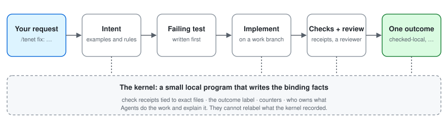

<div align="center">

# Tenet

**A test-first engineering loop for GitHub Copilot.**<br>
Tenet makes Copilot write the failing test first, check its own work, and say plainly what it did and did not prove.

[](https://github.com/vedprakash-m/tenet/actions/workflows/untrusted.yml)
[](https://github.com/vedprakash-m/tenet/releases/tag/v0.1.0)
[](LICENSE)


[Quick start](#quick-start) · [How it works](#how-it-works) · [First requests](#three-requests-to-start-with) · [Troubleshooting](#if-something-does-not-work) · [Documentation](#documentation)

</div>

> [!WARNING]
> **Tenet is an unqualified developer preview (v0.1.0).** It works on a branch and commits only files it wrote, but nothing has been qualified on a real host yet. Use it on throwaway projects, not on valuable work, secrets or production credentials. [Known open defects](#before-you-install) are listed below. Tried it? [Tell us what happened](https://github.com/vedprakash-m/tenet/issues/new/choose).

## What it is

Tenet is a plugin for GitHub Copilot in VS Code. You type `/tenet` and what you want. Tenet writes down what "done" means, has Copilot write a failing test first, runs your checks through a small local program that records the results, has a separate reviewer read the change, and ends with one plain label such as `checked-local` or `implemented-unverified`.

| Copilot on its own | Copilot with Tenet |
|---|---|
| Edits, then tells you it works | Writes a failing test first, so "works" has a definition |
| "Tests pass" is a sentence in chat | Each check is a receipt tied to the exact files it ran against; a later edit makes it stale |
| The author reviews its own work | A separate reviewer subagent reports findings, each with a severity |
| The summary can say anything | One outcome label, chosen by fixed rules, that names what was and was not shown |
| Your uncommitted edits are at risk | Work happens on a branch; Tenet commits only the files it wrote and asks before touching yours |

## How it works

<p align="center"></p>

The kernel is a small deterministic program in this repository. Agents explain and do the work; the kernel alone records the outcome, the receipts and the counters. Records live in `.tenet/` in your project, which is git-ignored. Tenet does not deploy, push or open pull requests, and it sends nothing anywhere except through Copilot's own model traffic.


## Quick start

_About five minutes._

**You need**
- **VS Code 1.142 or newer**, signed in to GitHub Copilot, with Copilot Chat in **Agent** mode. Plugins were observed working on 1.142.0 and 1.143.0; newer versions are unobserved. An older VS Code will not offer `/tenet`.
- **A Copilot plan and organization policy that allow agent mode, plugins and subagents.** Work and school accounts often do not. You will find out in step 3; see [If something does not work](#if-something-does-not-work).
- **[Node.js](https://nodejs.org) 22.12 or newer** and **Git** with your name and email set (`git config --global user.name` and `user.email`). Check: `node --version`, `git --version`.
- **macOS or Linux.** On Windows, Tenet only reads and reviews; every command that changes anything is refused.

**1. Download and unpack the plugin.** No build step. In a terminal:

```bash
mkdir -p ~/tenet-plugin && cd ~/tenet-plugin
curl -fsSLO https://github.com/vedprakash-m/tenet/releases/download/v0.1.0/tenet-plugin-v0.1.0.tgz
curl -fsSLO https://github.com/vedprakash-m/tenet/releases/download/v0.1.0/tenet-plugin-v0.1.0.tgz.sha256
shasum -a 256 -c tenet-plugin-v0.1.0.tgz.sha256   # on Linux: sha256sum -c tenet-plugin-v0.1.0.tgz.sha256
mkdir plugin && tar -xzf tenet-plugin-v0.1.0.tgz -C plugin
```

The check must print `tenet-plugin-v0.1.0.tgz: OK`. If it does not, stop and download again. (No `curl`? Download the two files from the [release page](https://github.com/vedprakash-m/tenet/releases/tag/v0.1.0) into `~/tenet-plugin` and run the last two lines.)

Now confirm the plugin's program runs on your machine, before involving VS Code:

```bash
node plugin/kernel/tenet.mjs inspect --view help | head -c 120
```

You should see JSON starting with `{"version":"0.1.0-m0"`. If you see an error instead, your Node is too old or missing; fix that first.

**2. Tell VS Code where the plugin is.** Print the line you need:

```bash
echo "\"$(pwd)/plugin\": true"
```

Open your user `settings.json` (Command Palette, then "Preferences: Open User Settings (JSON)") and add the two settings below, pasting that line where the path goes:

```json
"chat.plugins.enabled": true,
"chat.pluginLocations": {
  "/path/printed/above/plugin": true
}
```

If you already have `chat.pluginLocations`, add the new line inside it instead of a second copy. Then run "Developer: Reload Window".

**3. Say hello.** Open a project folder in VS Code, open Copilot Chat, switch to **Agent** mode and send:

```text
/tenet help
```

Tenet answers from its local program, with its version and what it can do, and starts no work. The first time, VS Code asks you to approve a terminal command; choose "Allow in this Session" and it will not ask again this session. You are set up. If `/tenet` is not offered, see [If something does not work](#if-something-does-not-work).

## Three requests to start with

Pick the row that matches what you have. Everything else about a task can be said in plain words after `/tenet`.

| You have | Try this | Changes your files? |
|---|---|---|
| Any Git project, and you want a low-risk first look | `/tenet-review review my uncommitted changes` (make a small edit first so there is something to review) | **No.** Read-only; its review file goes to the system temp folder. Only uncommitted changes against `HEAD` can be reviewed today. |
| A TypeScript or JavaScript project with Vitest, on a branch you can throw away | `/tenet fix: saving a reminder with an empty title returns a server error, and it should say the title is required` (use your own bug) | Yes, on a work branch; it commits only files it wrote. |
| An empty folder | `/tenet build a small API for tracking reminders, with sign-in` | Yes. Tenet offers its starter (TypeScript API with tests in place), asks how to set up Git, and needs the network to install packages. |

[docs/user/starter-requests.md](docs/user/starter-requests.md) walks through each. Not sure? Start with the review: it cannot change your files, so it is the cheapest way to see how Tenet talks and what a finding looks like.

## What to expect, and how long it takes

- Tenet states how careful it will be for this task, and asks only what it cannot decide itself. Expect a few questions at the start of a change.
- For a change it writes down examples and rules, then asks you to confirm or correct any examples or assumptions it added.
- A failing test comes first. Your tests, types and lint then run through the kernel; each result is tied to the exact files it ran against, and a later edit makes it stale.
- A reviewer subagent reads the change and reports findings, each with a severity.
- The report ends with one outcome. `checked-local` means the required checks and review passed on your machine; it is not owner acceptance and not production readiness. The others (`implemented-unverified`, `prototype`, `findings-only`, `blocked`) say what was missing. A project without Vitest ends at `implemented-unverified`; that is the honest label for "built, not fully checked", not an error.
- **Time and cost are unmeasured.** A change is several steps, each using Copilot requests, so a small fix takes longer and uses more requests than asking Copilot directly. No one has recorded typical numbers yet. Try a small change first.

**You stay in control.** Say "stop", "pause" or "cancel" at any time; Tenet always honors it. Say "undo" to preview reverting the work's commits. Tenet does not deploy, push or open pull requests. For your own uncommitted edits, Tenet leaves them alone, says which files are yours, and asks before touching a file you changed.

Handy commands: `/tenet status` (where things stand, starts nothing), `/tenet why` (why the last decision or outcome), `/tenet help`. To change how it talks to you, say "be brief", "explain more" or "only interrupt for decisions".

More: [What Tenet adds](docs/user/what-tenet-adds.md).

## If something does not work

Run this in your project folder for a plain-language preflight (replace the path with yours):

```bash
node ~/tenet-plugin/plugin/kernel/tenet.mjs inspect --view doctor | node -e 'let s="";process.stdin.on("data",d=>s+=d).on("end",()=>{for(const c of JSON.parse(s).data.checks)console.log(c.ok===true?"ok  ":c.ok===false?"FAIL":"?   ",c.name+":",c.detail)})'
```

`FAIL` lines say what is wrong (not a Git repository, no Git name and email, Node or Git missing). `?` means unknown, for example `test runner` in a project without Vitest; that only lowers the assistance level.

- **`/tenet` is not offered in chat.** In order: (1) VS Code is 1.142 or newer; (2) chat is in **Agent** mode; (3) both settings are in your *user* `settings.json`, and the path is the `plugin` folder that holds `plugin.json`; (4) you ran "Developer: Reload Window"; (5) start a new chat. VS Code keeps its own copy of the plugin and may need a reload to pick up changes.
- **Nothing about plugins exists in your settings or chat.** Your Copilot plan or organization may disable agent mode, plugins, custom agents or subagents. See "If policy blocks installation" below.
- **Tenet says it can only give an advisory review.** The host's terminal did not find Node.js 22.12 or newer. Install it from nodejs.org, reload, and run `node --version` in VS Code's own terminal.
- **Tenet refuses to change anything.** You are on Windows, or the folder is not a Git repository, or Git has no name and email. The preflight above shows which.
- **The terminal approval keeps appearing.** Choose "Allow in this Session". How approvals behave beyond that is unobserved.
- **You updated the plugin and nothing changed.** Point `chat.pluginLocations` at the new folder and reload the window.
- **Anything else, or it surprised you.** Open an [install-help or host-observation issue](https://github.com/vedprakash-m/tenet/issues/new/choose). Run `/tenet help` and paste only its version line; do not paste code, secrets or personal paths.

## Before you install

**No host tuple or release is qualified.** Treat this as a developer preview, not a supported installation.

**Known open safety defects in this preview.** Use Tenet only on disposable projects without valuable work, sensitive data or credentials.
- Undo and cleanup removal are implemented and covered by deterministic tests, but their preservation behavior on the installed VS Code/Copilot host is not qualified.
- Recovery after an interruption can remove a file that matches what Tenet meant to write, even if someone else created it, and does not always report what it did.
- On Windows, Tenet can follow linked installed Vitest metadata and read a file outside the project. Do not use Tenet in untrusted workspaces or with untrusted installed dependencies.

- **Prerequisites.** VS Code 1.142 or newer with GitHub Copilot Chat in agent mode and `chat.plugins.enabled` on; Node.js 22.12 or newer (Tenet reuses your Node and installs nothing); Git with your name and email set, and a Git repository for the project. Full checking needs a TypeScript or JavaScript project that uses Vitest. Other setups get a lower assistance level, which Tenet states in its first message.
- **Permissions and executable content.** The plugin ships one bundled helper, `plugin/kernel/tenet.mjs`, that the agent runs with your Node through the host's terminal tool. The host asks you to approve terminal commands. Tenet's own project checks (your tests, linters, servers) also run as local processes. No observer hooks ship in this preview; any future hooks are gated on qualification. The plugin ships no network client.
- **Publisher and verification.** The marketplace publisher is **not designated**. [v0.1.0](https://github.com/vedprakash-m/tenet/releases/tag/v0.1.0) is a hand-published GitHub pre-release with a SHA-256 file; there is no signed tag, provenance attestation or authenticated publisher. The checksum shows your download matches that build, not who made it. To check the source yourself, confirm the repository and commit, inspect the source, then run `npm ci` and `npm run build`; the generated `plugin/SHA256SUMS` checks local payload bytes only. The source repository is [vedprakash-m/tenet](https://github.com/vedprakash-m/tenet). `/tenet help` reports the running kernel's version (`0.1.0-m0` is the build in v0.1.0); see the [release verification procedure](docs/release/release-verification.md).
- **Autopilot.** Under Copilot's Autopilot, the host can answer native questions automatically, and Tenet cannot tell your answers from automatic ones. Questions about scope, protected paths, remote or destructive actions, risk and owner acceptance are therefore asked in plain chat, and every decision record made under Autopilot is unverifiable. Do not use Autopilot for work where that matters.
- **If policy blocks installation or a required feature.** An organization or plan policy can disable agent mode, agent plugins, custom agents or subagents. Tenet cannot see the policy and does not try to get around it. The recovery path is the host's own: read the message VS Code or Copilot shows, ask whoever manages your Copilot organization settings to allow the missing feature, or use an account where it is allowed. Until then Tenet does not work, and Copilot without the plugin is unchanged. Setting names and messages are unobserved: no blocked install has been recorded.

Full details: [docs/user/install-and-remove.md](docs/user/install-and-remove.md).

- **Prerequisites.** VS Code 1.142 or newer with GitHub Copilot Chat in agent mode and `chat.plugins.enabled` on; Node.js 22.12 or newer (Tenet reuses your Node and installs nothing); Git with your name and email set, and a Git repository for the project. Full checking needs a TypeScript or JavaScript project that uses Vitest. Other setups get a lower assistance level, which Tenet states in its first message.
- **Permissions and executable content.** The plugin ships one bundled helper, `plugin/kernel/tenet.mjs`, that the agent runs with your Node through the host's terminal tool. The host asks you to approve terminal commands. Tenet's own project checks (your tests, linters, servers) also run as local processes. No observer hooks ship in this preview; any future hooks are gated on qualification. The plugin ships no network client.
- **Publisher and verification.** The marketplace publisher is **not designated**. [v0.1.0](https://github.com/vedprakash-m/tenet/releases/tag/v0.1.0) is a hand-published GitHub pre-release with a SHA-256 file; there is no signed tag, provenance attestation or authenticated publisher. The checksum shows your download matches that build, not who made it. To check the source yourself, confirm the repository and commit, inspect the source, then run `npm ci` and `npm run build`; the generated `plugin/SHA256SUMS` checks local payload bytes only. The source repository is [vedprakash-m/tenet](https://github.com/vedprakash-m/tenet). `/tenet help` reports the running kernel's version (`0.1.0-m0` is the build in v0.1.0); see the [release verification procedure](docs/release/release-verification.md).
- **Autopilot.** Under Copilot's Autopilot, the host can answer native questions automatically, and Tenet cannot tell your answers from automatic ones. Questions about scope, protected paths, remote or destructive actions, risk and owner acceptance are therefore asked in plain chat, and every decision record made under Autopilot is unverifiable. Do not use Autopilot for work where that matters.
- **If policy blocks installation or a required feature.** An organization or plan policy can disable agent mode, agent plugins, custom agents or subagents. Tenet cannot see the policy and does not try to get around it. The recovery path is the host's own: read the message VS Code or Copilot shows, ask whoever manages your Copilot organization settings to allow the missing feature, or use an account where it is allowed. Until then Tenet does not work, and Copilot without the plugin is unchanged. Setting names and messages are unobserved: no blocked install has been recorded.

Full details: [docs/user/install-and-remove.md](docs/user/install-and-remove.md).


<details>
<summary><b>Status and evidence</b></summary>

The [November 4 implementation audit](docs/audits/2026-11-04/implementation-audit.md) is a historical assessment of earlier source; its findings need reconciliation against subsequent repairs. The active progress record for personal target A is `specs/re-plan.md`. The deterministic evidence below is for implementation commit `b7869a09613984b127504503d81b14e08f2e5a90`:

| Area | State |
|---|---|
| Kernel, plugin, starter recipe, deterministic tests | Exact-source [`untrusted` 44885756509](https://github.com/vedprakash-m/tenet/actions/runs/44885756509) and [`system-budgets` 44885756487](https://github.com/vedprakash-m/tenet/actions/runs/44885756487) pass on `b7869a0`, including hosted source, Ubuntu/macOS bundle/UAT and Windows lanes. Green deterministic CI does not qualify an installed host; this checkout is not a release artifact. |
| Production capacity approval | Still open. The central pipeline/verbs/decisions group uses 248,083 characters against the prior approved 247,219 ceiling. The enforced 248,256 ceiling is explicitly proposed, not owner-approved; green lint is not approval of that change. |
| Qualified tuple (host, extension, model, OS) | **Unrecorded.** No tuple is qualified. |
| Installing and running on VS Code Copilot | **Partly observed** on VS Code 1.142.0 and 1.143.0 (October 19 and 20, 2026): the plugin loaded from a local plugin location; the kernel ran from the host's snapshot copy of the plugin; real multi-step tasks ran through `finish`. The Copilot extension version was not recorded. |
| Reviewer subagent | **Partly observed.** A reviewer was dispatched several times on VS Code, and a partial result was refused and retried. Not observed: the reviewer's real tool list or host enforcement of its restrictions, actual context isolation, parallel dispatch, a cancelled or dead reviewer, and `usages`. |
| Approval behavior | **Unobserved** beyond one terminal approval ("Allow in this Session") per session. The approval mode is recorded as `unknown`. |
| A 15-minute command through the host's terminal tool | **Unobserved.** The one attempt measured a test-runner timeout, not the host. |
| Enable, disable, uninstall and update of the plugin | **Unobserved.** |
| Which instruction file the host loads, `.tenet/` exclusion from host indexing, token-estimate accuracy | **Unobserved or inconclusive.** |
| Hooks | None ship. The kernel finds edits made outside its own calls by comparison. |
| Copilot CLI | Early hypotheses only. Not part of this release line. |
| Publisher, signed release, checksums, provenance | **Partly published.** The v0.1.0 pre-release has a plugin tarball and SHA-256 file, hand-published. There is no signed tag, provenance attestation or designated publisher. |

Capabilities described in this repository are intended outcomes until their gates pass.

The current objective is a controlled developer preview for technical builders, installed from the v0.1.0 tarball or from source. Installed-host evaluation is intended to cover a small brownfield change, a starter journey, read-only review and interruption/resume with unrelated staged and dirty edits. These journeys are not yet qualified. Use disposable synthetic projects without sensitive data or production credentials; this is not a preservation guarantee for valuable work. The separate schema-2 protocol candidate is not included. Native Windows mutation support is not approved.

The [schema-1 bridge candidate](docs/schema-1-bridge.md) adds rollback-terminal and writer-fence safeguards. It is not a published or qualified bridge; schema-2 activation remains blocked until the required bridge is available and its actual artifact is pinned.

</details>

<details>
<summary><b>Support matrix and assistance levels</b></summary>

No combination is currently qualified. These observations are not support claims:

Every combination without a dated native suite run for the current model is labeled **not yet evaluated with the current model**. Historical observations below do not evaluate today's model. Rerun the native suite monthly and whenever a model change is observed; `.github/workflows/model-drift.yml` opens a monthly reminder without running a model or changing support claims. If the model is unobservable, claims stop at the last evaluation date.

| Environment | Status |
|---|---|
| VS Code with GitHub Copilot on macOS arm64 | Partly observed; no complete qualified tuple |
| VS Code with GitHub Copilot on Linux | Host behavior unobserved; not qualified |
| VS Code with GitHub Copilot on Windows | Read-only inspection only; mutating kernel calls are refused; not qualified |
| Copilot CLI, other editors or agents | Outside this release line or untested; not supported |

Tenet states one assistance level for each project and task:

| Level | What Tenet can do | Highest endpoint |
|---|---|---|
| L0 Refuse | Explain why a required boundary cannot be met | `blocked` |
| L1 Inspect | Read, explain and review source | `findings-only` |
| L2 Plan | Propose requirements, plan items and a readiness task | `findings-only` |
| L3 Implement, unqualified | Implement and run available checks outside the qualified profile | `implemented-unverified` |
| L4 Qualified local | Implement inside the qualified profile with full evidence | `checked-local` |
| L5 Deliver | Planned for R1.1; not available in this release line | `delivered` |

</details>

## Install from source

Use this route if you want to build the plugin yourself, or to try a newer commit than the release:

```bash
git clone https://github.com/vedprakash-m/tenet.git
cd tenet
npm ci
npm run build
```

Then add the repository's `plugin/` folder to `chat.pluginLocations`, as in the quick start. VS Code keeps its own snapshot copy of the plugin and may not pick up edits until it refreshes it. See [docs/user/install-and-remove.md](docs/user/install-and-remove.md).

## Update

There is no automatic update path, and plugin update and stored-record migration have not been qualified. To move to a newer release, download and unpack it into a new folder, point `chat.pluginLocations` at that folder and reload. Do not assume an active contract or older `.tenet/` state can migrate safely; finish or abandon work in progress first. See [Install and remove](docs/user/install-and-remove.md).

## Remove

In each project where you used Tenet, ask "help uninstall" before removing the plugin from `chat.pluginLocations`. The residue listing is incomplete; review it and the cleanup preview before confirming removal. Tenet removes a run entry only while it still matches the preview; it never removes `.tenet/`. Optionally remove `.tenet/` yourself after uninstalling; this deletes Tenet's project records. Installed-host uninstall and cleanup behavior remain unobserved. See [docs/user/install-and-remove.md](docs/user/install-and-remove.md).

## Documentation

| For users | For maintainers |
|---|---|
| [What Tenet adds](docs/user/what-tenet-adds.md) | [CONTRIBUTING.md](CONTRIBUTING.md) |
| [Three starter requests](docs/user/starter-requests.md) | [SECURITY.md](SECURITY.md) |
| [Install and remove](docs/user/install-and-remove.md) | [NOTICE](NOTICE) |
| [The Autopilot limit](docs/user/autopilot.md) | Specifications: [PRD](specs/PRD.md), [tech spec](specs/tech-spec.md), [UX spec](specs/ux-spec.md) |
| [The qualified tuple, as it stands](docs/user/qualified-tuple.md) | Progress record: [re-plan](specs/re-plan.md) |

Found a problem or tried it on your setup? [Open an issue](https://github.com/vedprakash-m/tenet/issues/new/choose); host observation reports are how this preview improves.

<details>
<summary><b>Offline evaluation tools (maintainers)</b></summary>

Maintainers can validate static protocol files, replay hand-authored synthetic observations, or render a local campaign report:

```bash
npm run eval:validate -- --protocol <path>
npm run eval:replay -- --capture <path>
npm run eval:report -- --input <path> --format json|markdown|junit
```

`eval:report` reads a `CampaignReportInputV1` JSON file and writes `CampaignReportV2` in the selected format to stdout. Unique-defect recall and repeated critical detection are separate: each declared critical defect needs detections in at least four of the first five primary repetitions; retries do not count. Exit codes are 0 for report eligibility `pass`, 3 for `fail` or `inconclusive`, 2 for invalid input, and 1 for usage errors. Eligibility is computed from untrusted local declarations; it does not authorize a run, qualify a requirement, or establish support. Validation and replay are local-only and do not execute graders, capture host sessions, or contact a model.

</details>


## License

Tenet and its own starter-template code are licensed under the [MIT License](LICENSE). Retain the required copyright and permission notice when copying or distributing substantial portions. Your application code remains yours; using Tenet does not require source disclosure or give Tenet ownership of it. Third-party components retain their own licenses and notices, listed in [NOTICE](NOTICE). License selection is not a claim of release readiness or approval to publish.
