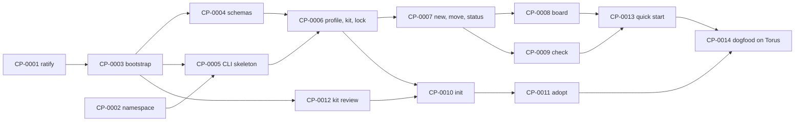

# Tenet plan

> Level L2 · Version 0.1 · Status: **draft, awaiting the Owner's approval** · Implements [prd.md](prd.md) §6 · Every item below becomes or is a packet in `packets/`

## 1. Milestones

| ID | Name | Packets | Gate | Status |
|---|---|---|---|---|
| M0 | Foundation | CP-0001 – CP-0003 | Owner signs `vision.md` v1 and approves `prd.md`, `tech-spec.md`, `ux-spec.md`, this plan and `standard/TENET.md` 0.1 | in progress |
| M1 | Usable by hand | CP-0004 – CP-0014 | This repository and Torus each run ≥5 packets with the CLI; `tenet check` passes in CI on Windows, macOS, Linux | not started |
| M2 | Enforced | Defined at M1 close | PRD §6 | not started |
| M3 | Governed agents | Defined at M2 close | PRD §6 | not started |
| M4 | Subscribed | Defined at M3 close | PRD §6 | not started |
| M5 | Managed workforce | Defined at M4 close | PRD §6 | not started |

Only the next milestone is planned in detail. Later milestones get packets when the one before closes, so the plan never runs ahead of what has been learned.

## 2. Order and dependencies (M0–M1)

CP-0004 and CP-0005 can run in parallel; so can CP-0008, CP-0009 and CP-0010.

## 3. M0 packets

### CP-0001 · spec · Ratify vision v1 and approve the M0 documents

- **Lane:** Deep · **Owner:** the Owner · **Serves:** V-P9
- **Do:** The Owner reads `vision.md`, corrects it, and signs version 1 (first ratification); after at least one day, ratifies again (second). Separately approves `specs/*.md` and `standard/TENET.md` 0.1.
- **Done when:** `vision.md` amendment log shows v1 ratified twice with dates; each spec's status line says `approved`; a ledger entry records both approvals.

### CP-0002 · ops · Namespace check and package name

- **Lane:** Quick · **Serves:** V-H5 · **Answers:** PRD OQ-01, TENET PQ-06
- **Do:** Check availability of `tenet` and candidate scoped names on npm, a GitHub organization, a domain for schema IDs, and trademark use in software. Record findings and a recommendation.
- **Done when:** A ledger decision names the package and schema host; `tech-spec.md` §3–4 are updated by a clarification commit.

### CP-0003 · ops · Repository bootstrap

- **Lane:** Quick · **Serves:** V-P9 · **Needs:** CP-0001 (approval to start building)
- **Do:** `git init`; `.gitignore`; `LICENSE` per PRD OQ-05; `package.json` with `"type": "module"`, `engines.node >=22`, `bin.tenet`; `tsconfig.json` (strict, ES2023, NodeNext); a CI workflow running `npm ci`, `npm run build`, `npm test` on Windows, macOS and Linux; hooks folder wired with `git config core.hooksPath .githooks`.
- **Done when:** CI is green on an empty test; the GitHub repository is created by the Owner (outward action).

## 4. M1 packets

Each task lists the files it touches and its proving cases. Tests use `node:test` and fixtures under `test/fixtures/`.

### CP-0004 · feature · Schemas 0.1

- **Implements:** R-010 · **Lane:** Standard
- **T-0004.1** Finalize `standard/schemas/packet.json`, `agent.json`, `tenet-profile.json` from the drafts. Add `receipt.json`, `findings.json`, `assignment.json`, `run-record.json`, `ledger-entry.json`, `tenet-lock.json`, `tenet-conformance.json`, `loop.json`.
- **T-0004.2** For each schema, add `test/fixtures/schemas/<name>/valid/*.yaml` (≥2) and `invalid/*.yaml` (≥3, each violating one rule, named for the rule).
- **T-0004.3** `test/schemas.test.ts`: every valid fixture passes; every invalid fixture fails with the expected keyword.
- **Proving:** `npm test -- schemas` passes; every example in `standard/TENET.md` code blocks tagged `yaml` with a recognized top-level key validates.

### CP-0005 · feature · CLI skeleton and output conventions

- **Implements:** R-081, R-083, R-084 · **Lane:** Standard
- **T-0005.1** `src/cli.ts` with `commander`; global options `--json`, `--cwd`, `--quiet`, `--verbose`; exit codes per tech spec §8.
- **T-0005.2** `src/core/output.ts`: `ok()`, `fail()`, `warn()`, `next()`, table rendering, `NO_COLOR` and non-UTF-8 fallbacks per UX §2; JSON mode collects the same facts into one object printed at exit.
- **T-0005.3** `src/core/errors.ts`: `TenetError {file, line?, rule, message, fix}`; the top-level handler prints UX §2.3 format and maps to exit codes.
- **T-0005.4** `src/core/fs.ts`: atomic write, path-escape refusal, forward-slash display paths.
- **Proving:** Snapshot tests of each output helper in colour, `NO_COLOR` and JSON; a write outside the root throws exit code 4.

### CP-0006 · feature · Profile, kit and lock loading

- **Implements:** R-050 · **Lane:** Standard
- **T-0006.1** `src/model/profile.ts`: load `tenet.yaml`, merge defaults from `<kit>/defaults/profile.yaml`, validate, resolve `kit_path`.
- **T-0006.2** `src/install/lock.ts`: read and write `tenet.lock`; `hashFile()` SHA-256; `verifyKit()` returns changed, missing and extra files.
- **T-0006.3** Self-hosting: when `kit_path` is `standard/`, skip lock verification and report `self-hosted` in `tenet check`.
- **Proving:** Fixture projects with an edited kit file, a missing file, and a clean kit give the expected `verifyKit()` results.

### CP-0007 · feature · `tenet new`, `move` (state only), `status`

- **Implements:** R-030, R-031 (state part) · **Lane:** Standard
- **T-0007.1** `src/core/ids.ts`: next ID for a prefix across the working tree and all local refs (`git for-each-ref` + `git ls-tree`); slug rules per tech spec §4.3.
- **T-0007.2** `src/model/packet.ts`: load, validate, append history (never rewrite earlier entries; write by re-emitting the file with the new entry appended and verifying the earlier bytes are unchanged).
- **T-0007.3** `src/engine/lifecycle.ts`: station graph, skipped stations per lane and type (tech spec §7.1), allowed moves. Gate conditions are stubs returning `not enforced` at step 1, except intake, triage and commit (tech spec §7.2 step 1).
- **T-0007.4** Commands `new`, `move`, `status`, `block`, `wait-owner`, `park`, `cancel`, `supersede`, `resume`.
- **Proving:** A packet created and moved through every station of each lane in a fixture repository; a forbidden move (e.g. intake → build) exits 1 naming the allowed next stations; a hand-edited history fails `tenet check` (CP-0009).

### CP-0008 · feature · `tenet board`

- **Implements:** R-032 · **Lane:** Standard
- **T-0008.1** `src/engine/board.ts`: group active packets by phase; card text per standard §7.1; WIP counts against the profile; flags for ageing and Owner queue age.
- **T-0008.2** Write `now.md` sections in UX §4 order; sections without data say "none". Vision scorecard lists horizons and metrics from `vision.md` tables with "not measured yet" until M5.
- **T-0008.3** Deterministic output: sort by phase, station order, priority class, age, ID; the "generated at" line uses the latest history timestamp, not the clock, unless `--now` is given.
- **Proving:** Golden-file test: the same fixture records give byte-identical `now.md` on all three platforms.

### CP-0009 · feature · `tenet check` (structure)

- **Implements:** R-033 (structure part) · **Lane:** Standard
- **T-0009.1** Checks 1, 2, 3, 4, 6 and 8 of standard §10, and K1, K2 of tech spec §9.
- **T-0009.2** Markdown link and anchor resolution (GitHub slug rules) for every `.md` file outside `.tenet/` and `node_modules/`.
- **T-0009.3** Append-only verification for `ledger/` and packet `history` using `git diff --cached` in the hook and `git log -p` from the last release in CI.
- **T-0009.4** `.githooks/pre-commit` runs `tenet check --staged`; CI runs `tenet check`.
- **Proving:** One fixture per check with exactly one violation; each reports one error with the right rule ID and fix; the clean fixture passes.

### CP-0010 · feature · `tenet init`

- **Implements:** R-020, R-022, R-023 · **Lane:** Standard
- **T-0010.1** Interview per UX §3.1; `--yes` defaults; refuse when `tenet.yaml` exists.
- **T-0010.2** Copy the kit, write the lock, write templates, the `AGENTS.md` block, the `CLAUDE.md` import line (`@AGENTS.md`) when that file exists or the host is claude-code, hooks, CI workflow and update-bot configuration.
- **T-0010.3** Create `CP-0001-adopt-tenet` as an `ops` packet listing every written file; run `tenet board`.
- **Proving:** In an empty temp repository `init --yes` produces a project that passes `tenet check`; a second run exits 0 with "already initialized; nothing changed".

### CP-0011 · feature · `tenet adopt`

- **Implements:** R-021 · **Lane:** Standard
- **T-0011.1** Same writes as `init`, skipping any existing path except generated blocks; report kept, skipped and appended paths per UX §3.2.
- **T-0011.2** Draft `vision.md` and `specs/prd.md` from templates, filling the Purpose section with the README's first paragraph and listing README headings as candidate capabilities, all marked `unsigned draft`.
- **T-0011.3** Issue import from a Markdown list (`issue_source.kind: markdown`): each unchecked item becomes an Intake packet. GitHub import waits for OQ-03.
- **Proving:** Adopting a fixture repository changes no pre-existing file byte (verified by hash) except appended blocks.

### CP-0012 · spec · Kit content review

- **Implements:** R-011 – R-014 · **Lane:** Standard
- **Do:** Review `standard/templates/`, `standard/agents/`, `standard/loops/` against TENET §14 and fill gaps: one reference definition per roster role, every criteria file, the judge protocol, every template named in R-011.
- **Done when:** Every role in TENET §14.2 has a definition with all seven body sections; the loop definition passes the static checks in tech spec §10.2 by inspection.

### CP-0013 · feature · Quick start

- **Implements:** D7 · **Lane:** Quick
- **Do:** `docs/quick-start.md`: install, `init`, first packet through Quick lane by hand, reading the board. Under 2 pages. Every command in it is run in CI against a temp repository.

### CP-0014 · experiment · Dogfood on Torus

- **Serves:** V-H1, V-M8 · **Lane:** Standard
- **Hypothesis:** A real project adopts Tenet at step 1 in under half a day and runs 5 packets without the Owner editing records by hand.
- **Do:** Run `tenet adopt` in Torus; replace `specs/process.md` there with a pointer to the standard; move 5 Torus packets through the CLI; log Owner minutes.
- **Kill criterion:** Adoption takes more than one day, or more than 2 hand edits of records are needed.
- **Done when:** A retrospective ledger entry records times, friction points and resulting packets.
