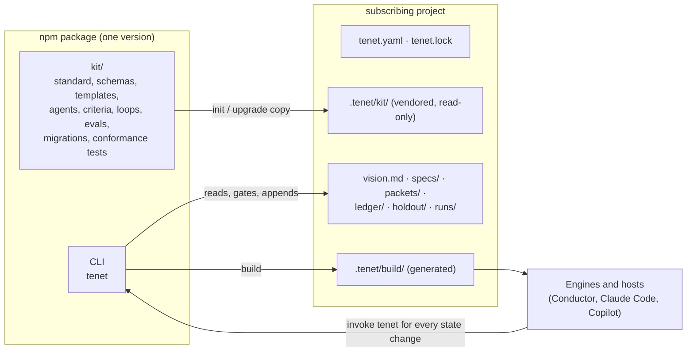

# Tenet technical specification

> Level L2 · Version 0.1 · Status: **draft, awaiting the Owner's approval** · Implements [prd.md](prd.md) · Rules: [standard/TENET.md](../standard/TENET.md) · Sections marked `<!-- invariant -->` need the Owner to change

## 1. Architecture

**One npm package, two halves: content (the kit) and a deterministic CLI that reads and writes files.** The CLI has no server, no database and no model client.



| Module | Responsibility | Depends on |
|---|---|---|
| `core/fs` | Atomic writes (temp file + rename), path normalization, glob | — |
| `core/yaml` | Parse and emit YAML preserving key order and comments where the file is user-edited | `yaml` |
| `core/schema` | Load JSON Schemas from the vendored kit; validate; format errors | `ajv` |
| `core/ids` | Allocate and parse IDs | `core/fs` |
| `core/git` | Read HEAD, compute the candidate digest, read trailers, list changed files | `git` executable |
| `model/profile` | Load `tenet.yaml` with defaults from the kit | `core/schema` |
| `model/packet` | Load, validate and append to packets | `core/*` |
| `engine/lifecycle` | The station graph, allowed transitions, gates | `model/*` |
| `engine/evidence` | Receipts, freshness, findings, endpoints | `model/*`, `core/git` |
| `engine/check` | `tenet check` rules | all `model/*` |
| `engine/board` | `now.md` and `now.html` | `model/*` |
| `engine/agents` | Agent definitions, overlays, roster, separation of duties | `model/*` |
| `compile/loop` | Loop definition parser, static checks, Conductor emitter | `engine/agents` |
| `compile/host` | Claude Code and Copilot emitters | `engine/agents` |
| `install` | `init`, `adopt`, `upgrade`, migrations, lock | `core/*` |
| `conform` | Conformance runner | `engine/*` |
| `cli` | Argument parsing, output formatting, exit codes | everything |

**Runtime.** <!-- invariant --> TypeScript compiled to ESM, Node 22 LTS or later, no native modules. Runtime dependencies are limited to `yaml`, `ajv`, `ajv-formats`, `commander` and `picomatch`; adding one needs a spec packet. `git` 2.40+ must be on the PATH for commands that read history or compute candidates.

## 2. Repository layout (this repository)

```text
tenet/
  AGENTS.md  CLAUDE.md  README.md  tenet.yaml  now.md  vision.md
  specs/                 prd.md tech-spec.md ux-spec.md plan.md
  standard/
    TENET.md             the normative standard (D1)
    schemas/             JSON Schemas (D2)
    templates/           document templates (D2)
    agents/              reference agent definitions, judge protocol, criteria (D2)
    loops/               engine-neutral loop definitions (D2)
    evals/               reference evaluation suites (M5)
    migrations/          upgrade migrations, one folder per target version (M4)
    conformance/         conformance tests and fixtures (M4)
  src/                   CLI source (M1)
  test/                  unit, fixture and end-to-end tests (M1)
  packets/  ledger/  holdout/  design/parked/  runs/
```

**Self-hosting.** This repository is a subscribing project of itself: its `.tenet/kit/` is not vendored; `tenet.yaml` sets `kit_path: standard/`, so the CLI reads the working copy of the standard. That is the only difference from any other project. The project's process document is `standard/TENET.md`; there is no `specs/process.md`.

## 3. Package layout

```text
<package>/
  package.json           "bin": {"tenet": "dist/cli.js"}, "engines": {"node": ">=22"}
  dist/                  compiled CLI
  kit/                   a copy of standard/ at release time, plus kit.json
  kit/kit.json           {"version": "0.1.0", "files": {"<path>": "<sha256>"}}
```

The package name is open (PRD OQ-01). The binary is always `tenet`. The release build copies `standard/` to `kit/`, computes `kit.json`, and fails if any file under `standard/` is not covered by a schema or listed as prose.

## 4. File formats

All machine-read files are YAML or JSON validated by a schema in `standard/schemas/`. Every schema has `$id: https://tenet.dev/schemas/<name>/<major>.json` (host to be confirmed with the package name) and `additionalProperties: false` except where a field is declared open. Timestamps are UTC ISO 8601 with minutes (`2026-11-22T14:05Z`). Text files use UTF-8 and LF.

### 4.1 `tenet.yaml` (profile)

Schema `tenet-profile`. Fields as in standard §17.1, plus:

| Field | Type | Default | Meaning |
|---|---|---|---|
| `standard` | semver range | `^<installed major>` | Versions this project accepts |
| `kit_path` | path | `.tenet/kit` | Where the CLI reads the kit |
| `adoption_step` | 1–6 | 1 | Highest adoption step switched on; gates for higher steps are not enforced |
| `engine` | object | `null` | `{target: conductor \| claude-code \| copilot, command: "<shell command template>"}` |
| `issue_source` | object | `null` | `{kind: github, repo: owner/name}` or `{kind: markdown, path: ...}` |
| `owner_queue_alert_days` | int | 2 | |
| `heartbeat_minutes` | int | 15 | Run heartbeat for `tenet run` |

Unknown top-level keys fail validation, except keys starting with `x-`.

### 4.2 `tenet.lock`

```yaml
standard: 0.1.0
package: {name: "<package>", version: 0.1.0, integrity: "sha512-..."}
installed: 2026-11-22T14:05Z
files:                       # every vendored file
  standard/TENET.md: "sha256:9b1c..."
  schemas/packet.json: "sha256:41aa..."
migrations_applied: []       # IDs of migrations run on this project
generated:                   # every generated file or block, with its source hash
  AGENTS.md#tenet: "sha256:..."
  .tenet/build/conductor/station-loop.yaml: "sha256:..."
```

### 4.3 Packets

`packet.yaml` as in standard §4.4 (schema `packet`). Additional rules:

- `history` entries have the fields `at`, `from`, `to`, `by` and optional `reason`, `lane`, `receipts`, `gate` (the list of satisfied conditions), `override` (an Owner override with reason).
- The packet folder name is `CP-nnnn-<slug>`, where slug is the title lower-cased, non-alphanumerics replaced by `-`, collapsed, trimmed to 40 characters.
- `definition.md`, `design.md`, `plan.md`, `review.md`, `validation.md`, `release.md` have YAML front matter with `packet` and `version`, then the sections their templates define. The CLI reads only the front matter and named sections it needs (§7).

### 4.4 Receipts

`packets/<id>/evidence/<yyyymmddThhmm>-<check>.yaml`, schema `receipt`, fields as in standard §6.2 plus `command` (what ran), `exit_code`, `log` (optional path), `run` (run ID when an agent ran it), `distinguishing` (`{baseline: fail|pass, candidate: fail|pass}`, optional). Never edited after creation.

### 4.5 Findings

`packets/<id>/reviews/<station>-round-<n>.json`, schema `findings`:

```json
{"packet": "CP-0042", "station": "review", "round": 1, "judge": "judge@3.0.0", "run": "run-...",
 "findings": [{"id": "F-0042-01", "severity": "major", "target": "src/gateway/dispatch.ts:88",
   "finding": "...", "evidence": "...", "criteria": "security@2", "status": "open"}],
 "resolved": ["F-0041-03"], "requires_human": false, "reason": null}
```

`review.md` is generated from these files plus dispositions recorded with `tenet finding <id> <fixed|withdrawn|deferred|accepted> --reason`.

### 4.6 Runs, assignments, results

| File | Schema | Written by |
|---|---|---|
| `runs/<yyyy-mm>/<run-id>/assignment.yaml` | `assignment` (standard §14.5) | `tenet run` or `tenet assign` |
| `runs/<yyyy-mm>/<run-id>/result.json` | the agent's `output_schema`, wrapped in `result` | The agent, via `tenet result` |
| `runs/<yyyy-mm>/<run-id>/run.json` | `run-record` (standard §14.10) | `tenet run` at end, or `tenet result` in mode B |

Run IDs are ULIDs prefixed `run-`.

### 4.7 Ledger

`ledger/L-nnnn-<slug>.md` with front matter `{id, kind, date, packet?, title}`; `kind` is one of `decision`, `pivot`, `milestone`, `amendment`, `probe`, `incident`, `review`, `retrospective`, `release`, `upgrade`, `close`. Append-only: the hook rejects modifications and deletions.

### 4.8 Agent definitions and overlays

Agent files follow standard §14.3 (schema `agent`). Overlays in `agents/overrides/<id>.md` have front matter `{extends: "tenet/<id>@<range>", ...narrowing fields}` and no body, or a body section `## Project notes` appended to the generated instructions.

## 5. IDs

| ID | Allocation |
|---|---|
| `CP-nnnn`, `L-nnnn`, `E-nnnn` | Next integer above the highest existing in the repository (all branches seen by `git for-each-ref` plus the working tree), zero-padded to 4 |
| `T-nnnn.k` | Within a packet's `plan.md` |
| `R-nnn`, `HS-nnn` | Assigned by the author; `tenet check` verifies uniqueness |
| `F-nnnn-kk` | Packet number and sequence within the packet |

Two branches can still allocate the same number. `tenet check` reports the duplicate; `tenet renumber <old> <new>` fixes it and rewrites references in the packet.

## 6. Candidate digest

<!-- invariant --> The candidate is `{base, digest}`:

- `base` is the abbreviated commit the packet branched from, recorded at Build entry.
- `digest` is the first 12 hex characters of SHA-256 over the sorted list of `<path>\0<blob sha>\n` for every file in the packet's change set (files differing between `base` and the working tree, including untracked files not ignored), excluding `packets/<id>/evidence/`, `packets/<id>/reviews/`, `runs/` and `now.*`.

Any edit to a changed file, or a new changed file, produces a new digest and makes every earlier receipt stale. `tenet candidate <packet>` prints the current value.

## 7. Lifecycle engine

### 7.1 Station graph

<!-- invariant --> Forward edges: `intake → triage → shape → commit → design → plan → build → verify → review → validate → integrate → release → observe → close`. Loop-back edges: `verify → build`, `review → build`, `validate → build`, `validate → shape`, `observe → release`, and any rewind to an earlier station with `--reason`. Lane and type rules (standard §5.2) mark stations as skipped; a move over skipped stations is one transition and the history entry lists them in `skipped`.

| Lane or type | Skipped stations |
|---|---|
| Quick | design; validate unless a holdout scenario covers a changed requirement; release and observe when `deploys: false` and no artifact is published |
| Standard | release and observe when `deploys: false` and no artifact is published |
| Deep | none |
| `spec` | design, plan, build, verify, validate, release, observe |
| `agent` | none; verify runs the evaluation suite; release is shadow → canary → full |

### 7.2 Gates

Each gate is a list of named conditions. `tenet move` evaluates the exit gate of the current station and prints every condition with pass or fail. A condition whose adoption step is above `adoption_step` is reported as `not enforced` and does not block.

| Exit of | Conditions | Step |
|---|---|---|
| intake | `type` set; no open packet with the same normalized title | 1 |
| triage | `lane`, `priority`, `serves` (≥1, each exists in `vision.md`), `appetite` set; `due` set when `fixed-date` | 1 |
| shape | `definition.md` exists and has the sections Intent, Requirement deltas, Acceptance basis, Holdout, Non-goals, Appetite; every delta has an ID; Holdout names IDs or says "none applies:" with a reason | 2 |
| commit | a history entry with `by` = the Owner, or a policy authorization within `commit_delegation` | 1 |
| design | `design.md` exists; a findings file for station `design` with convergence (standard §14.4) | 3 |
| plan | `plan.md` has ≥1 task; each task names the acceptance-basis items it covers | 2 |
| build | every task marked done; ≥1 commit with a `Tenet-Task` trailer for each task | 2 |
| verify | a fresh `pass` receipt for every check in the lane's required list; a `distinguishing` receipt for each behavior-changing delta | 2 |
| review | convergence on the latest review round; no open blocker | 2 |
| validate | every named holdout scenario has a passing result in `validation.md`; Owner acceptance recorded when lane is Deep | 4 |
| integrate | packet commits reachable from the main branch; a fresh pass receipt on the integrated candidate | 2 |
| release | `release.md` records exposure 100% or publication with checksum | 5 |
| observe | guardrail observations ≥ profile `observe` count with no breach | 5 |

The required checks per lane come from `tenet.yaml` `checks:` (default `{quick: [unit], standard: [lint, types, unit, acceptance-basis], deep: [lint, types, unit, integration, acceptance-basis]}`).

### 7.3 Holding states

`tenet block <packet> --by <E|CP>`, `tenet wait-owner <packet> --question "<text>"`, `tenet park <packet> --until "<condition>"`, `tenet cancel <packet> --reason`, `tenet supersede <packet> --by <CP>`. Each appends history and sets `status`. `tenet resume <packet>` returns to `active` when the holding reason is cleared (the blocker closed, the Owner answered).

### 7.4 Endpoint computation

<!-- invariant --> `tenet close` evaluates the endpoints of standard §6.4 from the top of the table down and assigns the first whose requirements hold, except that `prototype` and `findings-only` are taken from the packet's declared `intent_kind` when set. For `implemented-unverified` it lists each missing, stale, inconclusive or skipped item. The endpoint, the list, and the ledger entry ID are appended to history.

### 7.5 Stop rule

`tenet move` and `tenet receipt` compute stop-rule signals from history, receipts and findings: sessions at the station (distinct run IDs), same failure signature (normalized first error line of failed receipts), flip-flops (alternating `approach` tags in plan entries), review rejections with the same finding ID, spent vs appetite. When a threshold in `stop_rule` is met, the command refuses forward moves and prints `tenet escalate <packet>` as the next action. Signals that cannot be computed from files (contradiction, repeated silence) are raised by agents with `tenet escalate`.

## 8. Commands

Every command accepts `--json` (machine output on stdout, human messages suppressed), `--cwd <path>` and `--quiet`. Exit codes: 0 success, 1 a check or gate failed, 2 usage error, 3 environment error (missing git, unreadable file), 4 refused by policy (permission, freeze, separation of duties).

| Command | Reads | Writes | Notes |
|---|---|---|---|
| `init [--yes]` | kit | profile, lock, `.tenet/kit/`, templates, `AGENTS.md` block, `CLAUDE.md` import line, hooks, CI workflow, update-bot config, first `ops` packet | Refuses if `tenet.yaml` exists; interview prompts from UX spec §3 |
| `adopt [--yes] [--no-issues]` | repository, issue source | as `init`, plus `vision.md` and `specs/prd.md` drafts from templates filled with README headings, plus Intake packets for open issues | Never modifies an existing file outside generated blocks; a conflicting path is reported and skipped |
| `new <type> "<title>" [--from <url>]` | profile | packet folder, `packet.yaml`, `log.md` | |
| `move <packet> <station>\|--next [--reason] [--override "<reason>"] [--accept-findings]` | packet, evidence, findings, profile | history entry, `now.md` | `--override` only for the Owner, recorded, never for invariant gates |
| `status <packet>` / `board` | packets | `now.md`, `now.html` (board) | |
| `claim <packet>[/<task>] --as <agent>` / `release` | packet | `claimed_by`, history | Claims expire after `claim_hours` (default 4) |
| `receipt <packet> --check <name> -- <command...>` | git | receipt | Runs the command, records exit code and test counts parsed from JUnit XML when `--junit <path>` is given |
| `finding <id> <disposition> --reason` | findings | disposition record | |
| `escalate <packet> [--task] [--signal]` | packet | escalation file, status `blocked` | Opens the template for the agent to fill |
| `close <packet>` | everything in the packet | endpoint, ledger entry, PRD statuses (built), `now.md` | |
| `check [--fix-generated]` | everything | nothing (or regenerated files with the flag) | The checks in §9 |
| `trace` | specs, packets | traceability section of `now.md` | |
| `agent new\|build\|check\|qualify\|promote\|retire\|scorecard` | agents, evals, runs | per subcommand | M3/M5 |
| `build --target <conductor\|claude-code\|copilot>` | loops, agents | `.tenet/build/<target>/`, host paths | §10, §11 |
| `run <packet> [--station]` | packet, profile, roster | assignment, claim, run record, receipts | Invokes `engine.command` with the assignment path |
| `assign` / `result` | — | assignment / result and run record | Mode B: called by the host-side loop skill |
| `inspect <run>` / `record <run> --findings <file>` | assignment, artifacts, findings | inspection result, findings file, history round | Loop steps; `record` computes convergence from the lane bar |
| `amend <packet>` | packet | a new `spec` packet, status `blocked` on it | The human gate's amend option |
| `freeze [--agent]` / `thaw` | — | `.tenet/state/freeze.yaml` | |
| `upgrade [<version>] [--dry-run]` | lock, package | kit, lock, generated files, migrations, `ops` packet | §12 |
| `conform [--level <n>]` | `tenet-conformance.yaml` | report | §13 |

## 9. `tenet check`

Runs standard §10's nine checks plus:

| Check | Rule |
|---|---|
| K1 kit integrity | Every file under `kit_path` matches `tenet.lock` (skipped when self-hosting) |
| K2 generated drift | Every generated file and block matches the hash of a fresh generation |
| K3 overlay narrowing | Every overlay is a subset of the definition it extends (§4.8, PRD R-053) |
| K4 roster | Every bound station has an `active` agent with a qualified tuple (step ≥6), or any agent (steps 3–5) |
| K5 separation of duties | No run record shows a forbidden pairing (standard §14.6) |
| K6 deprecated use | Lists deprecated fields and rules the project still uses (warning) |
| K7 trailers | Commits since the last release that touch L0–L2 have `Tenet-Amendment`, `Tenet-Clarification` or are part of a spec packet |

Output groups errors by file; each line is `<file>:<line> <rule-id> <message> → <fix>`.

## 10. Loop definitions and the Conductor compiler

### 10.1 Loop definition format

`standard/loops/<name>.yaml`, schema `loop`. The reference loop is [`standard/loops/station-loop.yaml`](../standard/loops/station-loop.yaml): `assign` (script) → `create` (agent) → `inspect` (script) → `judge` (read-only agent) → `record` (script) → `decide` (route) → `bump` (set) back to `assign`, or the `gate` (human gate) with options stop, revise, accept with findings, amend, each leading to an ending script step.

| Field | Meaning |
|---|---|
| `loop`, `version`, `description` | Name, semantic version, one paragraph |
| `inputs` | Names bound by the caller (`packet`, `station`, `lane`) |
| `vars` | Counters with initial values |
| `limits` | Values read from the profile, resolved at compile time where possible |
| `steps[]` | `{id, kind, ...}`; `next` overrides the default of the following step; `end` names an outcome and ends the loop |
| `outputs` | Fields a `script` step's JSON stdout must contain |

Expressions are limited to `${...}` references, comparisons, `&&`, `||`, `!` and integer `+`. No arbitrary code.

### 10.2 Static checks (`tenet build` refuses on failure)

1. Every `agent` step whose role is a creator is followed, before any `route`, by a `script` step with `inspects:` naming it and an `agent` step with a critic role.
2. Every cycle passes through a `set` that increments a counter bounded by a `route` condition.
3. Every `human_gate` lists `stop` first.
4. Every `route` has a final `when: "true"`.
5. No `agent` step has a role whose definition has `kind: critic` and write tools.

### 10.3 Conductor mapping

| Loop element | Conductor output |
|---|---|
| `agent` | An agent step with the generated instructions, the assignment path as input, and the model from the roster's qualified tuple |
| `script` | A script step running the command; stdout JSON becomes the step output |
| `set` | A set step |
| `route` | Conditional routes on the previous step (expressions translated one to one) |
| `human_gate` | A human-gate step whose options map to routes |
| `limits` | Workflow variables |

The emitter output is golden-tested against `test/golden/conductor/`. The first emitted workflow must reproduce the behavior of govaut's `workflows/engineering-loop.yaml` on its fixture packets.

## 11. Host compilers

| Target | Emits | Mode |
|---|---|---|
| `claude-code` | `.claude/agents/<id>.md` per definition (frontmatter `name`, `description`, `tools`, `model`), `.claude/skills/tenet-loop/SKILL.md` (the station loop as instructions that call `tenet assign`, `tenet result`, `tenet move`), `.claude/commands/tenet-*.md`, permission rules in `.claude/settings.json` (merged into a generated block) | B |
| `copilot` | `.github/agents/<id>.agent.md`, `.github/prompts/tenet-*.prompt.md`, `.github/copilot-instructions.md` generated block | B |

Every generated file begins with a comment naming its source, the kit version, the mode, and "generated, do not edit". The host paths are recorded in the lock under `generated`. The exact host formats are pinned in `standard/schemas/hosts/` and updated by patch releases when hosts change.

## 12. Install and upgrade engine

### 12.1 Vendoring

`init` and `upgrade` copy `kit/` from the package into `.tenet/kit/`, write the hashes into `tenet.lock`, and mark files read-only where the file system allows. Generated blocks are delimited:

```markdown
<!-- tenet:begin id=agents-map version=0.1.0 -->
...
<!-- tenet:end id=agents-map -->
```

Text outside the markers is never touched. A block whose content differs from its recorded hash is a local edit: `upgrade` stops and reports it.

### 12.2 Migrations

`standard/migrations/<to-version>/<nn>-<name>.mjs` exports `{id, description, appliesTo(lock), run(ctx)}`. `ctx` offers file read, YAML edit and write helpers limited to the project root, and a dry-run flag. Migrations are idempotent and recorded in `migrations_applied`. A migration may edit project records only to rename or restructure fields; it never changes a decision, status or history entry.

### 12.3 Upgrade classification

<!-- invariant --> `upgrade` computes a classification from the kit diff:

| Signal | Class |
|---|---|
| Any schema change that removes or renames a field, a new required gate condition, a removed rule | `major` |
| A reference agent whose tools, paths, network or budget widened; a criteria file whose severity rules changed; a gate changed | `owner-review` |
| Anything else | `auto` |

`auto` is reported only if the version change is patch or minor (or patch only below 1.0). The classification is written into the `ops` packet and printed as the first line of the upgrade summary so an update bot can label the pull request.

### 12.4 Update bot

`init` writes `renovate.json` with a package rule for the Tenet package: group name `tenet`, `postUpgradeTasks: ["npx tenet upgrade --ci"]`, automerge only when the `tenet:auto` label is set by the CI check. A Dependabot configuration and a GitHub Actions workflow that runs `tenet upgrade --ci` on Dependabot branches are written as the alternative.

## 13. Conformance kit

`standard/conformance/<step>/<rule-id>/` holds a fixture project (input files), a command to run, and expected outputs. `tenet conform` copies each fixture to a temporary folder, runs the implementation's declared command (for the CLI itself, `tenet`), and compares outputs with normalized timestamps and IDs. Results are written to `conformance-report.json` with pass or fail per rule ID.

## 14. Security

| Concern | Control |
|---|---|
| Model calls | None in the CLI; enforced by a test that the dependency tree has no network client beyond `fetch` used by `upgrade` and `adopt` |
| Network | Only `upgrade` (package registry, via npm) and `adopt` (the configured issue source); `--offline` disables both |
| Secrets | The CLI never reads environment variables except `TENET_*`, `CI`, `NO_COLOR` and the engine command's own; it never writes secrets into records |
| Path escape | Every write is resolved and refused outside the project root |
| Migrations | Run in-process with the restricted `ctx`; reviewed as part of each release packet |
| Generated permissions | Host permission files are generated from definitions only; overlays cannot widen them (K3) |
| Holdout | Build-station assignments never include `holdout/`; `tenet assign` refuses an input path under it for builder roles |

## 15. Testing

| Layer | What | Tool |
|---|---|---|
| Unit | Every module in §1, including the gate table, endpoint rules, digest, ID allocation | `node:test` |
| Fixtures | Sample projects under `test/fixtures/` for every command; outputs compared with golden files | `node:test` |
| End to end | `init` in a temp repo, ten packets through all stations with fake receipts, `close`, `board`, `upgrade` across two built packages | `node:test` with real `git` |
| Cross-platform | CI on Windows, macOS and Linux | GitHub Actions matrix |
| Conformance | The CLI runs the conformance kit against itself | `tenet conform` |
| Dogfood | This repository's own packets move with the built CLI from M1 | `tenet check` in CI |

Every PRD requirement lists its proving cases in the packet that builds it; `tenet close` marks it `built` only when they pass in CI.
