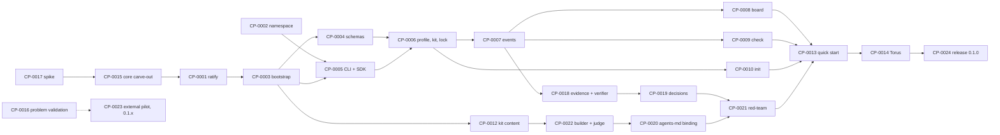

# Tenet plan

> Level L2 · Version 0.6 · Status: **draft, awaiting the Owner's approval** · Implements [prd.md](prd.md) §6 · Every item below is a packet in `tenet/packets/` · Budget: 6,000 tokens

**Context card.** M0 finishes the documents (vision, PRD and plan v0.6, tech and UX specs v0.5), carves the core out of the standard and spikes the riskiest mechanisms. M1 ships **0.1.0, the trust spine**: a person defines, an agent builds, CI proves, a person decides, the board shows it, and the red-team suite shows agents cannot fake it under the stated trust assumptions. 0.1.x point releases add convenience and the external pilot that measures V-H1. Tasks are written into each packet at Shape; this plan holds scope, order and proof.

## 1. Milestones

| ID | Release | Packets | Release gate | Status |
|---|---|---|---|---|
| M0 | — | CP-0001–0003, CP-0015–0017 | The Owner signs `vision.md` v1 and approves the PRD, tech spec, UX spec, this plan and the core of `kit/TENET.md` | in progress |
| M1 | 0.1.0 | CP-0004–0010, CP-0012–0014, CP-0018–0022, CP-0024 | Red-team cases pass at their declared levels; quick start passes on three platforms; a real GitHub repository runs the two-job workflow; this repository and Torus each close ≥5 verified changes on a pre-release | not started |
| M1 | 0.1.x | CP-0011, CP-0023, CP-0025–0039 | Each point release: its packets' checks and the red-team suite. V-H1 is measured across these releases | not started |
| M2–M5 | 0.2–1.x | Defined when the milestone before closes | PRD §6 | not started |

Every release ends with a retrospective that removes any rule or station whose cost exceeds its benefit, judged by severity and simulation as well as by what it caught.

## 2. Order and dependencies

Parallel tracks once CP-0006 lands: (a) CP-0007 → CP-0018 → CP-0019; (b) CP-0012 → CP-0022 → CP-0020; (c) CP-0008, CP-0009, CP-0010. CP-0016 runs alongside everything.

## 3. M0 packets

### CP-0017 · experiment · Feasibility spike (first)
- **Lane:** Quick · **Time box:** 2 days
- **Hypothesis:** On Windows, macOS and Linux: (1) decisions signed with `ssh-keygen -Y` over canonical JSON verify after squash, rebase and a shallow clone, and presence can be read from a security-key signature; (2) the two-job workflow writes `refs/tenet/evidence` without touching branches and rejects a bundle from another run; (3) two branches with concurrent moves reduce to the same `conflict` in either order; (4) the board reads main plus packet branches; (5) 10,000 event files reduce within R-082 with and without the cache; (6) a forge ruleset makes `refs/tenet/evidence` writable only by the attest job, and five concurrent attest jobs append without loss (otherwise the fallback binding is chosen); (7) the attest job can verify a `forge-verified` approval (listed account, enforced two-factor authentication, review covering the current subject); (8) the check job detects a check that edits tracked files.
- **Done when:** a ledger entry records what worked, on which platform, and every change needed in tech spec §4, §7 or §9 before CP-0004 freezes the schemas.

### CP-0015 · spec · Carve Tenet Core out of the standard
- **Lane:** Standard · **Needs:** CP-0017
- **Do:** Write Part I of `kit/TENET.md` (records, events, subjects, evidence, decisions and authority, rules from the target, lifecycle outcomes and precedence, agent and assignment contracts, skills and loops contracts, read model, guarantee levels and trust assumptions, budgets, conformance classes; ≤12,000 tokens; provisional rule IDs). Check it against the four reference cases (R-009). Freeze Part II with a banner: reference draft, not maintained until M2. Fix kit defects: correct the Spotify precedent from its source; remove the local govaut path; add `agent` to escalation levels; add the `factory` packet type and the factory-definition section to the core (DEC-21); write the proof table, decision-time snapshots, acceptance methods, outcome statuses, the two configuration planes, change purposes and scale tiers into Part I; build a trace from each vision promise to its requirement, schema, UX and milestone; define the method list, claim classes, evidence strengths, continuing obligations, finding classes, baseline-relative measurements and the config, data and flag subject names; move criteria to `kit/criteria/`; update the agent, profile and packet schemas, `kit/defaults/profile.yaml`, the station loop and this repository's `tenet.yaml` (structured `extra_checks`, pinned checks).
- **Done when:** Part I is within budget with IDs on every "must"; a cross-check table shows Part I and the four specs agree; schemas and loop validate.

### CP-0016 · experiment · Problem validation and baselines (alongside M1)
- **Do:** 5 interviews with maintainers who delegate real changes to agents, each including the **decision-reconstruction exercise** (R-075): four questions about 2–3 of their real past changes, answered with their current tools, timed and independently scored. Replay 10 Torus changes for best-effort baselines of lead time, throughput and false "done" claims. Record, for each real change, the original disputed decision, the cost of getting it wrong, the systems consulted, and the time spent producing records as well as reading them; include a wrong approval, a correct refusal, a correct acceptance and a truly unknown case. Record Torus's current health indicators as its baseline. Recruit the external pilot (OQ-05) from a team that already runs agents.
- **Kill or pivot:** if the exercise shows no meaningful time or correctness gap, narrow the first adopter or the entry point (release, hand-off or incident) before 0.1.x.
- **Done when:** a ledger entry records findings, baselines and the pilot project.

### CP-0001, CP-0002, CP-0003
- **CP-0001 Ratify** (Deep, needs CP-0015): the Owner signs the vision v1 twice, a day apart, and approves the specs and Part I.
- **CP-0002 Namespace** (Quick): npm name, schema host, existing projects with the same name. Ledger decision.
- **CP-0003 Bootstrap** (Quick, needs CP-0001): `package.json`, `tsconfig.json`, licence, CI on three platforms, hooks.

## 4. M1 packets for 0.1.0

| Packet | Implements | Scope | Proving |
|---|---|---|---|
| CP-0004 Schemas 0.1 | R-010, R-173, R-179, R-180 | The slice's schemas, with receipts of every kind (including proof, simulation and differential payloads), dimension and method fields, case manifests and baseline-relative measurements; ≥2 valid and ≥3 invalid fixtures each | Fixtures pass or fail with the expected keyword |
| CP-0005 CLI skeleton and output | R-048, R-080, R-081, R-083, R-084 | CLI and SDK entry points; output helpers; errors; exit codes; atomic writes | CLI and SDK return the same facts; snapshots in colour, `NO_COLOR` and JSON |
| CP-0006 Profile, kit and lock | R-050, R-053, R-104, R-109 | Governance plane (`tenet.yaml`): profile, packs, paths, pinned checks, protected set, approvals, size limits, areas; lock and kit verification; overlays; loading policy from the target branch | A policy edited on a branch is ignored and flagged; execution fields in `tenet.yaml` are refused |
| CP-0007 Events, new, move, status | R-018, R-030, R-031, R-037, R-039, R-091, R-185 | Event files with `prev`; causal reduction; conflicts and `resolve`; ULIDs and aliases; `task done`; identity-only `packet.yaml`; migration of existing histories; property tests of the evaluator over generated event histories | Same reduction in any arrival order; concurrent moves give `conflict`; every legacy packet survives migration |
| CP-0008 Board | R-032, R-073, R-082 | `board.json` and `now.md` from main, packet branches and the evidence store; phases from the pack; replay labels; flow with sample sizes; cost with source | Same refs and as-of time give byte-identical output on three platforms |
| CP-0009 Check | R-008, R-033, R-038 | Standard §10 checks; K1–K3, K7–K12; token budgets; hooks | One fixture per rule with exactly one violation |
| CP-0010 Init | R-020, R-022–R-024 | Interview; base footprint; optional integrations (two-job workflow, security-key decision key, hooks); evidence refspec; readiness report | `init --yes` writes only the base footprint; a second run changes nothing |
| CP-0012 Kit content | R-011, R-014, R-016, R-017, R-142, R-171, R-174 | Templates; `minimal` pack with quick and standard lanes and its work types; `station` and `fix` loops; skills "work a packet" and "review with findings"; definition template with claim class, method, pass rule and case IDs per acceptance item, a worked example and faithfulness prompts | Pack and loops pass static checks; skills within budget |
| CP-0018 Evidence and the CI verifier | R-026, R-034, R-035, R-036, R-100, R-103, R-110, R-146, R-170, R-172 | Subjects; receipts with dimension, method and executed-case manifests; acceptance-item matching by case; completion rules; two-job verifier with tamper detection; evidence store with retry; protected-set diff including proving cases of built requirements; continuing obligations; distinguishing checks that must fail as expected; gate snapshots; replay labels; observations; `close` with promotion of preservation items; stop events; size limits; `doctor` | Real GitHub repository: a protected pull request, a rebased base, a merge, a fork pull request and a retried job each give one correct outcome; a skipped mapped case leaves its item unresolved |
| CP-0019 Decisions | R-090, R-101, R-102, R-108, R-123 | Decision requests posted on the pull request; the proof table; `forge-verified` approvals read by the attest job; `tenet decide` with content signatures; subject staleness; scope-changing options; owners, keys, decision rights; `resolve-conflict` and `change-policy` | A pull-request approval by a listed owner counts; an edited, unlisted or stale one does not; an ordinary key gives `[key]` |
| CP-0020 agents-md binding | R-040, R-042, R-044, R-046, R-047, R-105, R-107, R-111, R-124, R-156 | `AGENTS.md` block and skills; loop steps `assign`, `result`, `inspect`, `record`; `agent check`; critic inspector with `incomplete`, `pre-existing` and `confirmed`; independence facts; pinned tests in the standard lane; assignment inputs tagged by trust; run records with actor chain, environment, usage and cost | A real host session works a quick and a standard packet end to end |
| CP-0021 Red-team suite | R-063, R-106 | Every R-106 case, plus a skipped mapped case, a baseline that failed in the harness, and a change breaking an earlier packet's guarantee, as automated tests with their declared levels | Each case refused or reported at its level |
| CP-0022 Reference agents (builder, judge) | R-012, R-013, R-015 | Builder and judge definitions; judge protocol; criteria; the 5-case activation test | `agent check` passes; the judge passes its activation test |
| CP-0013 Quick start | D8 | Install, first quick change, first standard change, reading the board, setting up verified work | Every command runs in CI against a temporary repository |
| CP-0014 Dogfood on Torus | V-H1, V-M8 | `init` in Torus; ≥5 verified changes for 0.1.0, ≥10 across 0.1.x, including a **three-change sequence**: introduce a guarantee, refactor while keeping it, extend it across another boundary; time per station from events | Kill: setup over one day, or more than 2 hand edits of records |
| CP-0024 Release 0.1.0 | R-004, R-005 | Changelog, `kit.json`, archive and checksums, npm with provenance, tag, `release` decision | Package installs and passes the quick start on three platforms |

## 5. M1 packets for 0.1.x

| Packet | Implements | Scope |
|---|---|---|
| CP-0011 Adopt | R-021, R-027, R-028 | `adopt` without semantic claims; discovery packet; imports from issues, spec-tool folders and pull requests by reference |
| CP-0023 External pilot | V-H1, R-075 | One project outside the steward's own closes ≥10 verified changes; reconstruction exercise before and after |
| CP-0025 Express lane | R-092, R-181 | Granted by the attest job; limits; denied paths, including configuration, data and flag changes with runtime effect; per-area counts; separate flow |
| CP-0026 Claude Code binding | R-042 | Agents, skills, settings and protected-write hook; capability table |
| CP-0027 Independent reader | R-064 | A read-only evaluator written from Part I alone, without the SDK, run on the fixtures |
| CP-0028 Shaper and verifier agents | R-012 | Definitions, skills "write a definition" and "stop and escalate", activation tests |
| CP-0029 Delegation and escalation | R-036, R-108 | `delegate` with expiry; `escalate` |
| CP-0030 HTML board and SARIF | R-032, R-034 | `now.html`; SARIF report parsing |
| CP-0031 Factory definition and the Warp mapping | R-120, R-121, R-125, R-131 | Factory-definition schema and validation; recorded per run; protected; `factory` packets; declared routing; published mapping from Warp Factories and a Symphony-style dispatcher with a worked conformance claim |
| CP-0032 Decisions on pull requests and visual evidence | R-123, R-130 | Pull-request decision edge cases (edited or withdrawn reviews, revocation, review threads); screenshots and recordings as attestations on the subject |
| CP-0033 Campaigns | R-140, R-141, R-155 | Campaign record with target snapshot, child packets, inherited approval within scope, counts and stop threshold; campaign view |
| CP-0034 Areas, readiness and approvals by risk | R-143, R-144, R-145, R-147 | Areas in the profile; `doctor --readiness`; lane readiness; intake dispositions; the approvals table; review queue |
| CP-0035 Merge queue and flaky-test quarantine | R-152, R-153 | Merge-queue verification in the attest job; `quarantine-check` decisions with expiry; re-checking the obligations a quarantined check covered |
| CP-0036 Check categories and mutation evidence | R-150, R-151 | Check dimensions and methods, fix hints into the `fix` loop, mutation denominators, `catching_tests` with its unit |
| CP-0037 Attribution definitions | R-159 | Who selected, authored, reviewed, authorized and released each change; autonomy and agent-authored shares |
| CP-0038 Scoped rules, session links and steering | R-157, R-158 | Directory-scoped rules attached by `assign`; `session_url`, `preview_url`, `run.steered`, subrun summaries |
| CP-0039 Health indicators and ratchet | R-175, R-176, R-177, R-178 | Health indicators per area with the ratchet and `accept-health-regression`; architecture rules; health in readiness; check owners; durability; docs referring to missing code |

## 6. Questions raised at M0 and where they are answered

| Question | Answer |
|---|---|
| Skills shipped? | Process skills in the open format (R-017); stack skills through pinned overlays |
| Loops shipped? | `station` and `fix` in 0.1.0, more later; usable as is, tunable, replaceable (R-014) |
| Delivery velocity? | Verified changes per week, lead time in hours (median and 85th percentile), decision wait, cost with source; DORA measures with the standard pack (tech spec §14) |
| Documents outgrowing context? | Token budgets, section-level assignments, archive-then-compact or split (tech spec §5) |
