# Tenet plan

> Level L2 · Version 0.8 · Status: **draft, awaiting the Owner's approval** · Implements [prd.md](prd.md) §6 · Every item below is a packet in `tenet/packets/` · Budget: 6,000 tokens · Previous version: `archive/specs/plan.md@0.7.md`

**Context card.** M0 runs three short spikes on the riskiest mechanisms, writes the kernel from what they show, and stops paper review at the ready-for-pilot checklist (vision, PRD and catalog v0.8; tech and UX specs v0.7; plan v0.8). M1 ships the **spec kit** first (0.1.0-alpha.0: the spec process, no CI needed), then **acceptance receipts** (alpha.1), then **0.1.0-alpha** inside this repository, then **0.1.0, the kernel**: seven primitives, one container and one gate rule, with the `minimal` pack pull-request native. In it, a person defines, an agent builds, CI proves, a person decides, the board shows it, and the red-team suite shows agents cannot fake it under the stated trust assumptions. 0.1.x point releases add convenience and the external pilot that measures V-H1. Tasks are written into each packet at Shape; this plan holds scope, order and proof.

## 1. Milestones

| ID | Release | Packets | Release gate | Status |
|---|---|---|---|---|
| M0 | — | CP-0001–0003, CP-0015–0017, CP-0040, CP-0041 | The ready-for-pilot checklist holds; the Owner signs `vision.md` v1 and approves the PRD, tech spec, UX spec, this plan and the kernel | in progress |
| M1 | 0.1.0-alpha.0 (spec kit) | CP-0004, CP-0005, CP-0006, CP-0009, CP-0010, CP-0012, CP-0044 | This repository and Torus run their specs under it; a maintainer outside the steward sets it up from the docs in under an hour | not started |
| M1 | 0.1.0-alpha.1 (acceptance receipts) | CP-0018 | Measured on Torus and with two CP-0016 interviewees: Owner minutes to check an agent's pull request fall; false "done" claims caught; record overhead under 2 minutes per change; setup under 1 hour | not started |
| M1 | 0.1.0-alpha (internal) | CP-0007, CP-0008, CP-0019, CP-0021, CP-0042 | This repository closes ≥3 verified changes on it in the quick lane; red-team cases pass at their levels | not started |
| M1 | 0.1.0 | CP-0013, CP-0014, CP-0020, CP-0022, CP-0024 | Quick start passes on three platforms; a real GitHub repository runs the two-job workflow; this repository and Torus each close ≥5 verified changes, at least 2 in the standard lane | not started |
| M1 | 0.1.x | CP-0011, CP-0023, CP-0025–0039, CP-0043 | Each point release: its packets' checks and the red-team suite. V-H1 is measured across these releases | not started |
| M2–M5 | 0.2–1.x | Defined when the milestone before closes | PRD §6 | not started |

**Scope freeze** (DEC-38). Until the checklist below holds, no new catalog entries or packets are added; new ideas become `idea` rows in the catalog. Every M0 packet has a time box; running over it means stop and escalate. Until 0.1.0-alpha.0, this repository keeps packets light (plan rows, stubs, logs, ledger entries) and notes Owner minutes per packet in its log.

**Ready-for-pilot checklist.** (1) The three spike results are in the ledger and the specs are updated to match; (2) the kernel (Part I) is written within 8,000 tokens and cross-checked against the specs; (3) every v0.8 change (L-0013) is applied; (4) the red-team list matches the guarantee table; (5) one three-change sequence has been run by hand on Torus with the documented records; (6) the decision-reconstruction exercise has run with at least two maintainers. Then reviews are of running software.

**Stop or change course.** Narrow the first adopter or the entry point if alpha.1 shows no fall in Owner minutes per agent pull request; change the trust spine to a separate evidence repository, labelled detected, if CP-0040 shows neither signed evidence nor a protected store works; re-slice if record overhead stays above 2 minutes per quick change after the alpha.

Every release ends with a retrospective that removes any rule or station whose cost exceeds its benefit, judged by severity as well as by what it caught.

## 2. Order and dependencies

```mermaid
flowchart LR
  CP17[CP-0017 spike A: identity] & CP40[CP-0040 spike B: evidence] & CP41[CP-0041 spike C: events] --> CP15[CP-0015 kernel] --> CP1[CP-0001 ratify] --> CP3[CP-0003 bootstrap]
  CP2[CP-0002 namespace] --> CP5
  CP3 --> CP4[CP-0004 schemas] & CP5[CP-0005 CLI + SDK] & CP12[CP-0012 kit content]
  CP4 & CP5 --> CP6[CP-0006 policy, kit, lock]
  CP6 --> CP9[CP-0009 check] & CP10[CP-0010 init] & CP44[CP-0044 spec ladder]
  CP9 & CP10 & CP12 & CP44 --> A0((alpha.0 spec kit))
  A0 --> CP18[CP-0018 receipts + verifier] --> A1((alpha.1 receipts))
  A1 --> CP7[CP-0007 kernel records] --> CP8[CP-0008 board] & CP42[CP-0042 replay, trust, close] & CP19[CP-0019 decisions]
  CP42 & CP19 --> CP21[CP-0021 red-team]
  CP8 & CP21 --> A((0.1.0-alpha))
  A --> CP22[CP-0022 builder + judge] --> CP20[CP-0020 agents-md] --> CP13[CP-0013 quick start] --> CP14[CP-0014 Torus] --> CP24[CP-0024 release 0.1.0]
  CP16[CP-0016 problem validation] -.-> CP23[CP-0023 external pilot, 0.1.x]
```

Parallel: the three spikes; then CP-0009, CP-0010, CP-0012 and CP-0044 after CP-0006; CP-0018 after the spec kit; then CP-0007 → CP-0042 and CP-0019, beside CP-0008. CP-0016 runs throughout.

## 3. M0 packets

### CP-0017, CP-0040, CP-0041 · experiment · Three feasibility spikes (first, in parallel)
Each is Quick, time-boxed to **2 days**, runs on a real GitHub repository on Windows, macOS and Linux, and ends with a ledger entry recording what worked, where, and every change needed in tech spec §3–§7 before CP-0004 freezes the schemas. **Stop rule:** if a hypothesis fails, record the fallback and its guarantee level; never extend the box.
- **CP-0017 · Spike A: identity and decisions.** Run on the first adopter's real setup: a private repository on its actual plan, a local agent holding the Owner's `gh` session, then a bot account and a sandboxed agent host. (1) Presence can be read from a security-key `ssh-keygen -Y` signature (touch tested on the Owner's machine; parsing and verification in CI on three platforms), and signed decisions verify after squash, rebase and a shallow clone; (2) the attest job verifies a review approval and a digest-bound comment, and records the two-factor status it can observe; (3) a pull request opened by the Owner's account cannot be approved by it, one opened by a bot can; (4) an agent with the Owner's session posting `/tenet decide` is caught by the spot checks; a stale digest is refused. *Records:* which trust assumptions hold on that setup, and the default readiness message. *Fallback:* forge decisions shown as detected; person-present via a security-key-signed commit.
- **CP-0040 · Spike B: signed evidence and two-job CI.** (1) The attest job signs a record with an OIDC token whose audience is the record's digest; the claims name the protected workflow and the target ref under the chosen trigger; verification works with Node's built-in crypto, including after a key rotation; (2) five concurrent attest jobs append without loss and a bundle from another run is rejected; (3) the check job, run with network denied and no shared cache, cannot poison the attest job through caches or artifacts, and a check that edits tracked files is detected; (4) on which forge plans merging can require the attest status. *Fallback:* a store only the attest job can write (ruleset, protected `tenet-evidence` branch or separate repository).
- **CP-0041 · Spike C: events, replay and performance.** (1) Two branches with concurrent moves reduce to the same `conflict` in either order; (2) the board reads main plus packet branches; (3) 10,000 event files reduce within R-082 on Windows with and without the cache; (4) case-ID tags (`[AB-1]`, JUnit property, CTRF field) are extracted from `node:test`, pytest and Go reports. *Fallback:* compaction (tier 2) from 0.1.0.

### CP-0015 · spec · Carve Tenet Core out of the standard
- **Lane:** Standard · **Needs:** CP-0017, CP-0040, CP-0041 · **Time box:** 3 days
- **Do:** Write Part I from the spike results in at most 8,000 tokens with provisional rule IDs, rules in prose and record shapes by reference to the schemas; forge mechanics stay in the binding section. It opens with **the spec process** (PRD §4.0), carried over from the current §3 and §9–§11, then **the kernel** as tech spec §3–§7 specify it. Part II holds the catalog's standard types and the pack-authoring contract, frozen as a reference draft until M2. Remove or remap references to old sections; check against the four reference cases (R-009); trace each vision promise to its requirement, schema, UX and milestone. Kit fixes: the Spotify precedent corrected from its source; no local govaut path; `agent` as an escalation level; the `factory` packet type; criteria in `kit/criteria/`; updated agent, profile and packet schemas, `kit/defaults/profile.yaml`, the station loop and this repository's `tenet.yaml`; then the banner is removed.
- **Done when:** Part I is within budget with IDs on every "must"; a cross-check table shows Part I and the four specs agree; schemas and loop validate.

### CP-0016 · experiment · Problem validation and baselines (alongside M1)
- **Do:** 5 interviews with maintainers who delegate real changes to agents, at least one outside application code, covering where their intent lives, how it reaches their agents and how stale it gets, and the **decision-reconstruction exercise** (R-075): four questions about 2–3 real past changes, answered with their current tools, timed and independently scored, including a wrong approval, a correct refusal, a correct acceptance and a truly unknown case. For each, record the disputed decision, the cost of getting it wrong, the systems consulted and the time spent producing and reading records. Replay 10 Torus changes for baselines of lead time, throughput and false "done" claims; record Torus's health indicators. Recruit the external pilot (OQ-05) from a team that already runs agents.
- **Kill or pivot:** if the exercise shows no meaningful time or correctness gap, narrow the first adopter or the entry point (release, hand-off or incident) before 0.1.x.
- **Done when:** a ledger entry records findings, baselines and the pilot project.

### CP-0001, CP-0002, CP-0003
- **CP-0001 Ratify** (Deep, needs CP-0015): the Owner signs the vision v1 twice, a day apart, and approves the specs and Part I.
- **CP-0002 Namespace** (Quick): npm name, schema host, existing projects with the same name. Ledger decision.
- **CP-0003 Bootstrap** (Quick, needs CP-0001): `package.json`, `tsconfig.json`, licence, CI on three platforms, hooks.

## 4. M1 packets for 0.1.0

| Packet | Implements | Scope | Proving |
|---|---|---|---|
| CP-0004 Schemas 0.1 | R-010, R-173, R-179, R-180, R-205 | Schemas for the seven primitives (minimal and full), the work item, policy, lock, pack, agent, loop, assignment, result, criteria and board; evidence payloads for check, measurement, attestation, observation and review (proof, simulation and differential names reserved for M2); ≥2 valid and ≥3 invalid fixtures each | Fixtures pass or fail with the expected keyword |
| CP-0005 CLI skeleton and output | R-048, R-080, R-081, R-083, R-084 | CLI and SDK entry points; output helpers; errors; exit codes; atomic writes | CLI and SDK return the same facts; snapshots in colour, `NO_COLOR` and JSON |
| CP-0006 Policy, kit and lock | R-050, R-053, R-104, R-109, R-204 | Policy loading from the target line (`tenet.yaml`, packs, lock); selectors and the tighten-only merge; strength minimums; proof table, approvals, size limits, areas, owners and `bots[]`; protected paths as claims; overlays; refusal of execution fields in `tenet.yaml` | A policy edited on a branch is ignored and flagged; overlapping selectors merge to the strictest |
| CP-0007 Kernel records, events and the gate rule | R-018, R-030, R-031, R-037, R-039, R-091, R-185, R-186, R-200, R-201, R-202, R-203 | Subjects, claims and decisions as records; event files with `prev`; station and status apart; reduction, conflicts and `resolve`; the gate rule with approval claims, waiver limits and unknown applicability; the argument in gate events; ULIDs and aliases; leases with paths; `new` with the branch and pull-request command; moves derived from forge state; `task done`; migration of existing histories; property tests of the evaluator | Same verdict in any arrival order; concurrent moves give a conflict; unknown applicability refuses; every legacy packet survives migration |
| CP-0008 Board | R-032, R-073, R-082 | Versioned `board.json` and `now.md` from main, packet branches and the evidence store; phases from the pack; dependencies; tentative moves; waivers per area; next actions with commands; `--since`; flow with sample sizes; cost with source; the fixture gallery | Same refs and as-of time give byte-identical output on three platforms; every gallery fixture renders |
| CP-0009 Check | R-008, R-033, R-038 | Structure, schemas and links; the spec ladder's change control and traceability (R-209, R-210); budgets; event and alias checks once CP-0007 lands; `--pack` for pack authors; hooks | One fixture per rule with exactly one violation |
| CP-0044 Spec ladder | R-207, R-208, R-209, R-210, R-211, R-212, R-213 | The default ladder in `tenet.yaml` and the `minimal` pack; level rules for who changes and approves each document; `spec` packets with deltas merged at Integrate; trailers; the `AGENTS.md` section on which levels apply and how to raise a wrong specification | This repository's specs pass `tenet check` with no exceptions; a build-run commit touching L1 is refused |
| CP-0010 Init | R-020, R-022–R-024 | Interview; base footprint; a `tenet.yaml` of at most 15 lines from CODEOWNERS and existing scripts; optional integrations (two-job workflow, forge decisions with the agents' bot identity, security key, hooks); readiness report naming each trust assumption that does not hold | `init --yes` writes only the base footprint; a second run changes nothing |
| CP-0012 Kit content | R-011, R-014, R-016, R-017, R-142, R-171, R-174, R-188 | Templates; `minimal` pack, pull-request native, with quick and standard lanes, selectors and work types; the pack-authoring contract; `station` and `fix` loops; skills "work a packet" and "review with findings"; definition template with claim class, methods, pass rule and case tags per acceptance item, a worked example and faithfulness prompts | Pack and loops pass static checks; skills within budget |
| CP-0018 Acceptance receipts and the two-job verifier | R-034, R-100, R-103, R-146, R-172, R-188 | Subjects with declared inputs; the hardened reference workflow; the check job's environment contract and tamper detection; case manifests matched by tag; distinguishing runs on the base for every behavior item; completion rules; the attest job signing evidence; evidence store with retry; protected-set diff; size limits; a pull-request status and a table of acceptance items proven, unproven or passing on the base | Real GitHub repository: a protected pull request, a rebased base, a merge, a fork pull request and a retried job each give one correct outcome; a skipped mapped case leaves its item unresolved |
| CP-0042 Replay, trust observations and close | R-026, R-035, R-036, R-110 | Gate snapshots and replay labels with tentative moves and their timeout; forge-state events signed by the attest job; observation of trust assumptions 1–3 and spot checks of assumption 4; `close` with the endpoint and ledger entry; stop data in gate events; `doctor`, including `--fetch-keys` | A move without evidence stays tentative and becomes unjustified after the timeout; a decision by the account whose agent opened the pull request is flagged |
| CP-0019 Decisions | R-090, R-101, R-102, R-108, R-123, R-203 | Decision requests on the pull request; the proof table in strict order; `forge-verified` approvals and digest-bound comments read by the attest job and written to the evidence store; two-factor status; `tenet decide` with content signatures; waive limits; subject staleness; scope-changing options; owners, keys, decision rights; `resolve-conflict` and `change-policy` | A pull-request approval by a listed owner counts; an edited, unlisted, stale-digest or self-waived one does not; an ordinary key gives `[key]` |
| CP-0020 agents-md binding | R-040, R-042, R-044, R-046, R-047, R-105, R-107, R-111, R-124, R-156, R-206 | `AGENTS.md` block and skills; loop steps `assign`, `result`, `inspect`, `record`; `agent check` with the new definition fields; an advisory critic whose findings are `introduced`, `exposed`, `inherited` or `uncertain` and `located` or `substantiated`, and whose invalid findings make a review `incomplete`; independence facts; pinned tests in the standard lane; trust-tagged inputs; run records with actor chain, environment, usage and cost | A real host session works a quick and a standard packet end to end |
| CP-0021 Red-team suite | R-063, R-106 | Every R-106 case for 0.1.0, including an agent using the Owner's forge session, an approval edited after recording, cache poisoning and artifact injection between the jobs, inserted skips, special-cased or deleted tests, substituted reports and planted test hooks, as automated tests with their declared levels | Each case refused or reported at its level; the list matches the guarantee table |
| CP-0022 Reference agents (builder, judge) | R-012, R-013, R-015 | Builder and judge definitions with `sponsor`, `acts_as`, `side_effects`, `may_propose`, `independence`, `abstain_when`; judge protocol; criteria; the 5-case activation test (advisory) | `agent check` passes; the judge passes its activation test |
| CP-0013 Quick start | D8 | Install; an agent drafts the vision and PRD from templates, the Owner approves; a spec change; a quick and a standard change; the board | Every command runs in CI against a temporary repository |
| CP-0014 Dogfood on Torus | V-H1, V-M8 | `init` in Torus; ≥5 verified changes for 0.1.0, ≥10 across 0.1.x, including a **three-change sequence**: introduce a guarantee, refactor while keeping it, extend it across another boundary; time per station from events | Kill: setup over one day, or more than 2 hand edits of records |
| CP-0024 Release 0.1.0 | R-004, R-005 | Changelog, `kit.json`, archive and checksums, npm with provenance, tag, `release` decision | Package installs and passes the quick start on three platforms |

## 5. M1 packets for 0.1.x

| Packet | Implements | Scope |
|---|---|---|
| CP-0011 Adopt | R-021, R-027, R-028 | `adopt`; discovery packet; imports from issues, spec-tool folders and pull requests |
| CP-0023 External pilot | V-H1, R-075 | One project outside the steward's own closes ≥10 verified changes; reconstruction exercise before and after |
| CP-0025 Express lane | R-092, R-181 | Granted by the attest job; limits; denied paths, including configuration, data and flag changes with runtime effect; per-area counts; separate flow |
| CP-0026 Claude Code binding | R-042 | Agents, skills, settings and protected-write hook; capability table |
| CP-0027 Independent reader | R-064 | A read-only evaluator written from Part I alone, without the SDK, run on the fixtures |
| CP-0028 Shaper and verifier agents | R-012 | Definitions, skills "write a definition" and "stop and escalate", activation tests |
| CP-0029 Delegation and escalation | R-036, R-108 | `delegate` with expiry; `escalate` |
| CP-0030 HTML board and SARIF | R-032, R-034 | `now.html`; SARIF report parsing |
| CP-0031 Factory definition and the Warp mapping | R-120, R-121, R-125, R-131 | Factory-definition schema, validation and recording; `factory` packets; routing; mappings from Warp Factories and a Symphony-style dispatcher |
| CP-0032 Decisions on pull requests and visual evidence | R-123, R-130 | Edited or withdrawn reviews, revocation, review threads; screenshots and recordings as attestations |
| CP-0033 Campaigns | R-140, R-141, R-155 | Target snapshot, child packets, inherited approval, counts, stop threshold, campaign view |
| CP-0034 Areas, readiness and approvals by risk | R-143, R-144, R-145, R-147 | Areas in the profile; `doctor --readiness`; lane readiness; intake dispositions; the approvals table; review queue |
| CP-0035 Merge queue and flaky-test quarantine | R-152, R-153 | Merge-queue verification in the attest job; `quarantine-check` decisions with expiry; re-checking the obligations a quarantined check covered |
| CP-0036 Check categories and mutation evidence | R-150, R-151 | Check dimensions and methods, fix hints into the `fix` loop, mutation denominators, `catching_tests` with its unit |
| CP-0037 Attribution definitions | R-159 | Who selected, authored, reviewed, authorized and released each change; autonomy and agent-authored shares |
| CP-0038 Scoped rules, session links and steering | R-157, R-158 | Scoped rules attached by `assign`; session and preview links; `run.steered`; subrun summaries |
| CP-0039 Health indicators and ratchet | R-175, R-176, R-177, R-178 | Health indicators with the ratchet and `accept-health-regression`; architecture rules; check owners; durability |
| CP-0043 Continuing promises and defeaters | R-035, R-170, R-187 | Promotion at close; protected proving cases; replace and retire decisions; impact rule; `defeated` from later failures, escapes, incidents and audits |

## 6. Questions raised at M0

Skills, loops, delivery velocity and documents outgrowing context were answered in L-0007 (R-017, R-014, tech spec §8 and §9).
