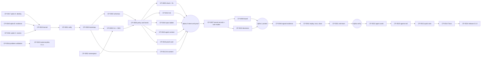

# Tenet plan

> Level L2 · Version 0.9 · Status: **draft, awaiting the Owner's approval** · Implements [prd.md](prd.md) §6 · Every item below is a packet in `tenet/packets/` · Budget: 6,000 tokens · Previous version: `archive/specs/plan.md@0.8.md` · 0.1.x packets: [plan/0.1.x.md](plan/0.1.x.md)

**Context card.** M0 runs three short spikes on the riskiest mechanisms, writes the kernel from what they show, and stops paper review at the ready-for-pilot checklist. M1 ships in four steps, each usable on its own: **intent and proof** (alpha.0: the starter ladder, agent context and an advisory proof card on every pull request; nothing blocks), **protect** (alpha.1: rules the Owner turns on block), **verify** (the internal alpha: signed evidence agents cannot fake), then **0.1.0** with the careful lane and reference agents. 0.1.x adds the `assure` level, promises and health, and the external pilot that measures V-H1. Tasks are written into each packet at Shape; this plan holds scope, order and proof.

## 1. Milestones

| ID | Release | Packets | Release gate | Status |
|---|---|---|---|---|
| M0 | — | CP-0001–0003, CP-0015–0017, CP-0040, CP-0041 | The ready-for-pilot checklist holds; the Owner signs `vision.md` v1 and approves the PRD, tech spec, UX spec, this plan and the kernel | in progress |
| M1 | 0.1.0-alpha.0 (intent and proof) | CP-0004, CP-0005, CP-0006, CP-0009, CP-0010, CP-0012, CP-0018, CP-0044, CP-0045 | First useful result in ≤10 minutes and first governed change in ≤60 minutes on an existing repository; 0 Tenet-specific manual steps per quick change; two outside maintainers succeed without help; this repository and Torus run on it | not started |
| M1 | 0.1.0-alpha.1 (protect) | CP-0007, CP-0008, CP-0019 | False blocks under 2 per 100 changes; record overhead under 2 minutes per change | not started |
| M1 | 0.1.0-alpha (verify) | CP-0021, CP-0042, CP-0046 | This repository closes ≥3 verified changes on it; red-team cases pass at their levels | not started |
| M1 | 0.1.0 | CP-0013, CP-0014, CP-0020, CP-0022, CP-0024 | Quick start passes on three platforms; a real GitHub repository runs the two-job workflow; this repository and Torus each close ≥5 verified changes, at least 2 in the careful lane | not started |
| M1 | 0.1.x | See [plan/0.1.x.md](plan/0.1.x.md) | Each point release: its packets' checks and the red-team suite. V-H1 is measured across these releases | not started |
| M2–M5 | 0.2–1.x | Defined when the milestone before closes | PRD §6 | not started |

**Scope freeze** (DEC-38). Until the checklist below holds, no new catalog entries or packets are added; new ideas become `idea` rows in the catalog. Every M0 packet has a time box; running over it means stop and escalate. Until 0.1.0-alpha.0, this repository keeps packets light (plan rows, stubs, logs, ledger entries) and notes Owner minutes per packet in its log.

**Ready-for-pilot checklist.** (1) The three spike results are in the ledger and the specs are updated to match; (2) the kernel (Part I) is written within 8,000 tokens and cross-checked against the specs; (3) every change from L-0013 to L-0016 is applied; (4) the red-team list matches the guarantee table; (5) one three-change sequence has been run by hand on Torus with the documented records; (6) the decision-reconstruction exercise has run with at least two maintainers. Then reviews are of running software.

**Stop or change course.** Narrow the first adopter or the entry point if alpha.0 shows no fall in Owner minutes per agent pull request, or outside maintainers cannot adopt it without help; change the trust spine to a separate evidence repository, labelled detected, if CP-0040 shows neither signed evidence nor a protected store works; re-slice if record overhead stays above 2 minutes per quick change after the alpha.

Every release ends with a retrospective that removes any rule or station whose cost exceeds its benefit, judged by severity as well as by what it caught.

## 2. Order and dependencies

Parallel: the three spikes; after CP-0006, the six alpha.0 packets side by side; then CP-0008 and CP-0019 after CP-0007. CP-0016 runs throughout.

## 3. M0 packets

### CP-0017, CP-0040, CP-0041 · experiment · Three feasibility spikes (first, in parallel)
Each is Quick, time-boxed to **2 days**, runs on a real GitHub repository on Windows, macOS and Linux, and ends with a ledger entry recording what worked, where, and every change needed in tech spec §3–§7 before CP-0004 freezes the schemas. **Stop rule:** if a hypothesis fails, record the fallback and its guarantee level; never extend the box.
- **CP-0017 · Spike A: identity and decisions.** Run on the first adopter's real setup: a private repository on its actual plan, a local agent holding the Owner's `gh` session, then a bot account and a sandboxed agent host. (1) Presence can be read from a security-key `ssh-keygen -Y` signature (touch tested on the Owner's machine; parsing and verification in CI on three platforms), and signed decisions verify after squash, rebase and a shallow clone; (2) the attest job verifies a native review approval and a `/tenet pick` reply bound to the head commit with its 10-minute window, and records the two-factor status it can observe; (3) a pull request opened by the Owner's account cannot be approved by it, one opened by a bot can; (4) an agent with the Owner's session replying `/tenet approve` is caught by the spot checks. *Records:* which trust assumptions hold on that setup, and the default readiness message. *Fallback:* forge decisions shown as detected; person-present via a security-key-signed commit.
- **CP-0040 · Spike B: signed evidence and two-job CI.** (1) Compare three ways to sign evidence so it verifies wherever it is stored and for as long as it is kept: a public signing service or forge attestations (and on which plans, and what a public log reveals), a key held as a secret only the protected workflow on the target can read, and an OIDC token verified when recorded (behavior after key rotation); pick the default for public and private repositories; (2) five concurrent attest jobs append without loss and a bundle from another run is rejected; (3) the check job, run with network denied and no shared cache, cannot poison the attest job, and a check that edits tracked files is detected; (4) on which forge plans merging can require the attest status. *Fallback:* a store only the attest job can write (ruleset, protected `tenet-evidence` branch or separate repository).
- **CP-0041 · Spike C: events, replay and performance.** (1) Two branches with concurrent moves reduce to the same `conflict` in either order; (2) the board reads main plus packet branches; (3) 10,000 event files reduce within R-082 on Windows with and without the cache; (4) case-ID tags (`[AB-1]`, JUnit property, CTRF field) are extracted from `node:test`, pytest and Go reports. *Fallback:* compaction (tier 2) from 0.1.0.

### CP-0015 · spec · Carve Tenet Core out of the standard
- **Lane:** Standard · **Needs:** CP-0017, CP-0040, CP-0041 · **Time box:** 3 days
- **Do:** Write Part I from the spike results in at most 8,000 tokens with provisional rule IDs, rules in prose and record shapes by reference to the schemas; forge mechanics stay in the binding section. It opens with **the spec process** (PRD §4.0), carried over from the current §3 and §9–§11, then **the kernel** as tech spec §3–§7 specify it. Part II holds the catalog's standard types and the pack-authoring contract, frozen as a reference draft until M2. Remove or remap references to old sections; check against the four reference cases (R-009); trace each vision promise to its requirement, schema, UX and milestone. Kit fixes: the Spotify precedent corrected from its source; no local govaut path; `agent` as an escalation level; the `factory` packet type; criteria in `kit/criteria/`; updated agent, profile and packet schemas, `kit/defaults/profile.yaml`, the station loop and this repository's `tenet.yaml`; then the banner is removed.
- **Done when:** Part I is within budget with IDs on every "must"; a cross-check table shows Part I and the four specs agree; schemas and loop validate.

### CP-0016 · experiment · Problem validation and baselines (alongside M1)
- **Do:** 5 interviews with maintainers who delegate real changes to agents, at least one outside application code, covering where their intent lives, how it reaches their agents and how stale it gets, and the **decision-reconstruction exercise** (R-075): four questions about 2–3 real past changes, answered with their current tools, timed and independently scored, including a wrong approval, a correct refusal, a correct acceptance and a truly unknown case. For each, record the disputed decision, the cost of getting it wrong, the systems consulted and the time spent producing and reading records. Replay 10 Torus changes for baselines of lead time, throughput and false "done" claims; record Torus's health indicators. Recruit the external pilot (OQ-05) from a team that already runs agents.
- **Kill or pivot:** if the exercise shows no meaningful time or correctness gap, narrow the first adopter or the entry point (release, hand-off or incident) before 0.1.x.
- **Done when:** a ledger entry records findings, baselines and the pilot project.

### CP-0001, CP-0002, CP-0003
- **CP-0001 Ratify** (Deep, needs CP-0015): the Owner signs the vision v1 twice, a day apart (this project runs its own vision at `assure`), and approves the specs and Part I.
- **CP-0002 Namespace** (Quick): the GitHub home is set (`github.com/vedprakash-m/tenet`, template `vedprakash-m/tenet-starter`; L-0020); still open: the npm name, the schema host, existing projects with the same name. Ledger decision.
- **CP-0003 Bootstrap** (Quick, needs CP-0001): `package.json`, `tsconfig.json`, licence, CI on three platforms, hooks.

## 4. M1 packets for 0.1.0

| Packet | Implements | Scope | Proving |
|---|---|---|---|
| CP-0004 Schemas 0.1 | R-010, R-173, R-179, R-180, R-205 | Schemas for the seven primitives (minimal and full), the work item, policy with `level` and `rules`, lock, pack, agent card, loop, assignment, result, criteria, proof card and board; evidence payloads for check, measurement, attestation, observation and review (proof, simulation and differential names reserved for M2); ≥2 valid and ≥3 invalid fixtures each | Fixtures pass or fail with the expected keyword |
| CP-0005 CLI skeleton and output | R-048, R-080, R-081, R-083, R-084 | CLI and SDK entry points; output helpers with plain-words errors and "why"; exit codes; atomic writes; the CI action | CLI and SDK return the same facts; snapshots in colour, `NO_COLOR` and JSON |
| CP-0006 Policy, levels, kit and lock | R-050, R-053, R-104, R-109, R-204, R-214 | Policy loading from the target line; the four levels and their defaults; selectors and the tighten-only merge; strength minimums; proof table, approvals, size limits, areas, owners and `bots[]`; protected surfaces in tiers; kit loaded from the pinned package or a vendored copy; overlays | A policy edited on a branch is ignored and flagged; each level yields its documented defaults |
| CP-0007 Kernel records, events, gate rule and rule modes | R-018, R-030, R-215, R-031, R-037, R-039, R-091, R-185, R-186, R-200, R-201, R-202, R-203 | Subjects, claims and decisions as records; rule modes and "would have blocked"; event files with `prev`; station and status apart; reduction, conflicts and `resolve`; the gate rule with approval claims, waiver limits and unknown applicability; the argument in gate events; ULIDs and aliases; leases with paths; `new` with the branch and pull-request command; moves derived from forge state; `task done`; migration of existing histories; property tests of the evaluator | Same verdict in any arrival order; concurrent moves give a conflict; unknown applicability refuses; every legacy packet survives migration |
| CP-0008 Board | R-032, R-073, R-082, R-216 | Versioned `board.json`, `now.md` and the single-file `now.html`; the default view (waiting for you, blocked, changed since you looked); phases on the shared vocabulary; dependencies; tentative moves; waivers; next actions with commands and `dispatch`; optional `active_runs`; friction counts per rule; `--since`; flow; the fixture gallery | Same refs and as-of time give byte-identical output on three platforms; every gallery fixture renders |
| CP-0009 Check, fix and split | R-008, R-033, R-038, R-219 | Structure, schemas and links; change control and traceability (R-209, R-210) without trailers; budgets with warnings; `tenet fix` for mechanical repairs; `tenet split`; event and alias checks once CP-0007 lands; `--pack`; hooks that warn | One fixture per rule with exactly one violation; `fix` repairs every mechanical fixture |
| CP-0044 Spec ladder | R-207, R-208, R-209, R-210, R-212, R-213, R-220 | Starter ladder (`intent.md`) and document sets per project type; level rules; spec deltas in pull requests or `spec` work items; the `AGENTS.md` section on levels; living specifications: affected sections on the proof card, agent-proposed deltas, a `garden` loop, spec debt | This repository's specs pass `tenet check` with no exceptions; a pull request changing L1 without the owner's approval is flagged |
| CP-0045 Agent context | R-049, R-211 | `tenet context` returning the applicable sections, acceptance items and rules within budget; the local MCP server (`context`, `check`, `status`, `next`, proposals); skills installed for the host | An agent in a real host session gets only the sections its task needs, through MCP and through skills |
| CP-0010 Init and upgrade | R-020, R-021, R-022–R-024, R-027, R-051, R-054 | The two starting paths: detection of checks, owners, forge and existing docs, or two questions and an intent template for a new project; one confirmation; five files or fewer; existing docs linked by reference; agent-drafted starter ladder marked `reported`; "Tenet can help now" and "upgrade when ready"; `tenet upgrade` and the lock-mismatch notice; `level` and `rules` commands | `init --yes` writes only the base footprint; a second run changes nothing; both starting paths (Torus, and an empty repository) reach a first useful result in ≤10 minutes |
| CP-0012 Kit content | R-011, R-014, R-016, R-017, R-142, R-171, R-174, R-188 | Templates; `minimal` pack, pull-request native, with explore, quick and careful lanes, selectors, work types and the phase vocabulary; the pack-authoring contract; `station` and `fix` loops; skills "work a packet" and "review with findings"; definition template with claim class, methods, pass rule and case tags per acceptance item, a worked example and faithfulness prompts | Pack and loops pass static checks; skills within budget |
| CP-0018 Proof card | R-034, R-103, R-146, R-172, R-188, R-218 | A proof job in ordinary CI: pinned checks, case manifests matched by tag, distinguishing runs per R-172, tests deleted, skipped or weakened, protected surfaces in tiers, size; the proof card posted and updated on the pull request, labelled advisory | On a real repository, a pull request shows proven, unproven and skipped items correctly; a skipped mapped case leaves its item unproven; a deleted test is reported |
| CP-0042 Replay, trust observations and close | R-026, R-035, R-036, R-110, R-217 | Gate snapshots and replay labels with tentative moves and their timeout; forge-state events signed by the attest job; observation of trust assumptions 1–3 and spot checks of assumption 4; `close` with the endpoint and ledger entry; stop data in gate events; safe failure per tech spec §7.6; `doctor` | A move without evidence stays tentative and becomes unjustified after the timeout; a decision by the account whose agent opened the pull request is flagged |
| CP-0046 Signed evidence and the two-job verifier | R-100 | The hardened reference workflow; the check job's environment contract and tamper detection; the attest job signing evidence by the method CP-0040 chose; the evidence store with retry; the proof card marked verified | Real GitHub repository: a protected pull request, a rebased base, a merge, a fork pull request and a retried job each give one correct outcome; a forged record fails verification |
| CP-0019 Decisions | R-090, R-101, R-102, R-108, R-123, R-177, R-203 | Decision requests on the pull request; native review approvals and `/tenet approve` or `/tenet pick` replies bound to the head commit; self-acceptance below `verify`, labelled; the proof table; waive limits; "not useful" marks on findings; subject staleness; owners and decision rights; `resolve-conflict` and `change-policy` | A listed owner's approval counts; an edited, unlisted or too-recent reply does not; a self-acceptance is labelled |
| CP-0020 agents-md binding | R-040, R-042, R-044, R-046, R-047, R-105, R-107, R-111, R-124, R-156 | `AGENTS.md` block and skills; loop steps `assign`, `result`, `inspect`, `record`; `agent check`; an advisory critic whose findings are `introduced`, `exposed`, `inherited` or `uncertain` and `located` or `substantiated`, and whose invalid findings make a review `incomplete`; independence facts; pinned tests in the careful lane; trust-tagged inputs; run records with actor chain, environment, usage and cost | A real host session works a quick and a careful packet end to end |
| CP-0021 Red-team suite | R-063, R-106 | Every R-106 case for 0.1.0, including an agent using the Owner's forge session, an approval edited after recording, cache poisoning and artifact injection between the jobs, inserted skips, special-cased or deleted tests, substituted reports and planted test hooks, as automated tests with their declared levels | Each case refused or reported at its level; the list matches the guarantee table |
| CP-0022 Agent cards (builder, judge) | R-012, R-013, R-015, R-206 | The agent card schema and host bindings; builder and judge cards; judge protocol; criteria; the 5-case activation test (advisory) | `agent check` passes; the judge passes its activation test; cards compile for two hosts |
| CP-0013 Quick start and first contact | D8, R-221 | The GitHub README's first screen and the four ways in (UX spec Part 0), including the agent prompt and the `tenet-starter` template repository; two quick starts following Part 1, an existing repository and a new project, each to a first merged change; then a spec change, a careful change and the board | Every command runs in CI against a temporary repository |
| CP-0014 Dogfood on Torus | V-H1, V-M8 | `init` in Torus; ≥5 verified changes for 0.1.0, ≥10 across 0.1.x, including a **three-change sequence**: introduce a guarantee, refactor while keeping it, extend it across another boundary; time per station from events | Kill: setup over one day, or more than 2 hand edits of records |
| CP-0024 Release 0.1.0 | R-004, R-005, R-221 | Changelog, `kit.json`, archive and checksums, npm with provenance, tag (installable with `npx github:`), the template repository updated, `release` decision | Package installs and passes the quick start on three platforms |

## 5. M1 packets for 0.1.x

In [plan/0.1.x.md](plan/0.1.x.md), split under the rollover rule (L-0016).

## 6. Questions raised at M0

Skills, loops, delivery velocity and documents outgrowing context were answered in L-0007 (R-017, R-014, tech spec §8 and §9).
