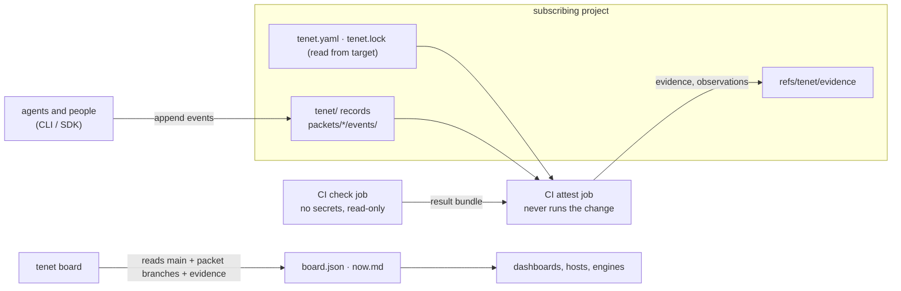

# Tenet technical specification

> Level L2 · Version 0.5 · Status: **draft, awaiting the Owner's approval** · Implements [prd.md](prd.md) · Rules: [kit/TENET.md](../../kit/TENET.md) · Sections marked `<!-- invariant -->` need the Owner to change · Budget: 16,000 tokens

**Context card.** One npm package: kit, deterministic CLI, SDK. Events (one file each, chained by `prev`) are the source of truth and are replayed by CI. Evidence comes from a two-job verifier and lives in a store only it writes. Decisions are signed in their content. Rules always come from the target branch and are judged against the snapshot recorded at decision time. Decisions carry proof at a declared strength (`forge-verified` by default). Configuration has two planes: `tenet.yaml` governs, optional `factory.yaml` describes execution. Every rule states its guarantee and the trust assumptions behind it. Built requirements stay protected after their packets close, and declared health indicators ratchet forward. 0.1.0 builds the `minimal` pack's trust spine (§8, §9). When CP-0015 moves the normative formats into the core, this document keeps only implementation detail.

## 1. Architecture

**The tooling reads and writes files and git. It has no server, no database and no model client.** Record paths (`vision.md`, `specs/`, `packets/`, `ledger/`, `holdout/`, `runs/`, `archive/`, `now.md`) are relative to the records folder (`paths.records`, default `tenet/`); other paths are relative to the repository root.



| Module | Responsibility |
|---|---|
| `core/fs`, `core/yaml`, `core/schema` | Atomic writes, path refusal; parse; validate against vendored schemas (`yaml`, `ajv`) |
| `core/git` | Object reads in batches, trees, diffs, refs, notes on the evidence ref |
| `core/sign` | Canonical JSON (RFC 8785); SSH signatures with `ssh-keygen -Y` |
| `model/*` | Profile, packs, packets, events, subjects, agents, skills, loops |
| `engine/reduce` | Causal reduction, replay, conflicts |
| `engine/lifecycle` | Gates, precedence, endpoints |
| `engine/evidence` | Receipts, freshness, trust, observations, guarantee levels |
| `engine/board`, `engine/metrics`, `engine/check` | Read model, flow, checks |
| `verify` | The two CI jobs |
| `compile/*`, `install`, `sdk`, `cli` | Bindings; init and lock; public API; commands |

**Runtime.** <!-- invariant --> TypeScript compiled to ESM, Node 22 LTS or later, no native modules. Runtime dependencies limited to `yaml`, `ajv`, `ajv-formats`, `commander`, `picomatch`; adding one needs a spec packet. Requires `git` 2.40+ and OpenSSH 8.9+ (`ssh-keygen -Y`).

**Scale tiers.** The same schemas, events and replay rules run on three stores. **Tier 1**, up to about 50 changes a week: event files in git. **Tier 2**, up to about 1,000 a week: git, with closed packets compacted into one `events.jsonl` each and evidence on the evidence store. **Tier 3**, organization scale: an external append-only store (M3–M4) behind a storage binding. Revisions are named by content-addressed IDs, so a non-git history can supply equivalent evidence.

## 2. Repository layout (this repository)

<!-- invariant --> **The folder that ships is the folder that is vendored.** `kit/` becomes `kit/` in the package and `.tenet/kit/` in a project, file for file.

```text
tenet/
  README.md LICENSE CONTRIBUTING.md AGENTS.md CLAUDE.md package.json tsconfig.json tenet.yaml
  kit/      SHIPPED AND VENDORED: TENET.md, CHANGELOG.md, schemas/, defaults/, templates/, packs/,
            agents/, criteria/, skills/, loops/; kit.json generated at release
  pkg/      SHIPPED, NOT VENDORED: migrations/, conformance/ (red-team, reference cases), evals/, hosts/
  src/ test/ docs/ examples/minimal/
  tenet/    this repository's records
```

Criteria move from `kit/agents/criteria/` to `kit/criteria/` (CP-0015), so content packets and agent packets touch separate folders. **Self-hosting:** `kit_path: kit`; no lock.

## 3. Package and channels

`package.json`: `"bin": {"tenet": "dist/cli.js"}`, `"exports": {".": "dist/sdk.js"}`, `"files": ["dist","kit","pkg"]`. Channels: npm with provenance (0.1.0); kit archive with `SHA256SUMS` (0.1.0); the two-job CI workflow template (0.1.0); update workflow (M4); local MCP server (M3).

## 4. File formats

YAML or JSON validated by `kit/schemas/`. Timestamps are UTC RFC 3339 with seconds (`2026-11-22T14:05:09Z`). Text is UTF-8 with LF. Hashes are full and algorithm-tagged (`sha256:…`, full git SHAs); displays abbreviate.

### 4.1 `tenet.yaml` (profile)

| Field | Default | Meaning |
|---|---|---|
| `standard` | `~<installed minor>` below 1.0 | Accepted range; exact version only in the lock |
| `kit_path`, `paths.records` | `.tenet/kit`, `tenet` | Kit and records locations |
| `pack` | `minimal` | Lifecycle pack or a path to one |
| `owners[]` | — | `{id, name, roles[], keys: [{public_key, added, revoked?}]}`. `id` is the signing principal; no email needed. `owner: <name>` remains a shorthand with no keys |
| `decision_rights` | owners decide everything reserved to people | `{<decision>: [<role>]}` for `approve-definition`, `accept-findings`, `accept-risk`, `override`, `change-policy`, `release`, `resolve-conflict`, `delegate`, `amend-vision` |
| `checks` | — | `{<name>: {run, report: junit \| ctrf \| sarif \| none, report_path, inputs: [<glob>], timeout_minutes}}`; `inputs` join the subject (§7) |
| `lane_checks` | `{quick: [unit], standard: [unit]}` | Checks each lane requires; `init` adds what it is told |
| `protect` | §9.4 defaults | Extra protected paths and keys (`package.json#/scripts`) |
| `express` | `{max_files: 10, max_lines: 200, per_area_per_day: 5, deny_paths: []}` | Limits; defaults are always denied too (§8.3) |
| `board.refs` | `["refs/remotes/origin/tenet/*"]` | Packet branch patterns the board reads |
| `trust` | `{evidence_ref: refs/tenet/evidence, forge: github}` | Evidence store and forge binding |
| `proof` | §9.5 table | Strength each decision kind needs; projects may only tighten it |
| `approvals` | `{express: 0, quick: 0, standard: 1, deep: 2, protected: person-present}` | Human decisions required by lane (R-145) |
| `size_limits` | `{quick: {files: 10, lines: 300}, standard: {files: 40, lines: 1500}}` | Larger changes are split or raised (R-146) |
| `health` | none | `{indicators: {<name>: {check, metric, rule, tolerance, scope, area}}}`; protected; ratchet in §8.4 (R-175) |
| `areas` | none | `{<name>: {paths, owners, decision_rights, wip}}`; decisions and boards resolve per area |
| `holdout` | `{mode: in-repo}` | `external` with `{ref, hash}` |
| `context_budgets` | §5 | Overrides |

Unknown keys fail validation, except `x-` keys. Packet branches are named `tenet/<alias>-<slug>`.

### 4.1a `factory.yaml` (execution plane, optional)

Describes how the factory runs; Tenet validates it, records its version on every run, and protects it (R-120, R-121). Fields: `workers` (role, agent definition, model or harness, skills, tool grants), `routing` (by lane, role, work type or measured complexity), `environments` (image, setup, network allowlist, secrets per worker; services, twins, observability and warm-pool hints from M2), `identities` (who each worker acts as), `channels`, `triggers` (M2), `scorers` and `comparison` suites (M2), `critics.families`, and `engine` (adapter ID). A project without `factory.yaml` runs in host-driven mode with defaults.

### 4.2 `tenet.lock`

`{standard, package: {name, version, integrity}, files: {<path>: <hash>}, skills: {<name>: {source, hash}}, migrations_applied, generated: {<path or block>: <hash>}}`.

### 4.3 Packets

```text
packets/CP-7f3a2q-gateway-dispatch/
  packet.yaml     identity only: alias, uid (ULID), title, type, work_type, campaign (optional), created
  definition.md   intent, requirement deltas, acceptance items (each with an ID, claim class, method, pass rule and case IDs), pinned tests, non-goals
  tasks.yaml      task IDs, titles and acceptance items covered (no state)
  log.md          narrative; append only
  events/         one file per event (§4.4)
  escalations/
```

### 4.4 Events

<!-- invariant --> **Events are the source of truth.** Each is one immutable file, `packets/<alias>/events/<id>.json`:

```json
{"id": "01JDX4Q7…", "prev": "01JDX4M2…", "type": "packet.moved", "packet": "01JDX3…",
 "time": "2026-11-21T08:40:12Z", "by": "builder@0.1.0", "run": "run-01JDX…",
 "data": {"from": "build", "to": "verify"}, "sig": null}
```

| Type | Kind | Data |
|---|---|---|
| `packet.created` | state | Identity; `source` reference when imported |
| `packet.changed` | state | New lane, risk, priority, appetite or title, with reason |
| `packet.moved`, `packet.status` | state | Station or holding status |
| `packet.closed` | state | Endpoint and the evidence list behind it |
| `conflict.resolved` | state | Kept event ID; signed |
| `decision.requested` | note | §4.6 |
| `decision.made` | state when it unblocks a gate | Signed answer (§9.5) |
| `task.done` | note | Task ID; progress, never evidence |
| `review.recorded` | note | §4.5 |
| `claim.taken`, `claim.released` | note | Expiry, strength |
| `run.started`, `run.ended` | note | Agent, model family, independence facts, cost with source |
| `stop.triggered`, `escalation.opened`, `escalation.resolved` | note | Signal; escalation ID and level |
| `gate.evaluated` | note | Gate, verdict, and the snapshot used: policy revision, evidence-store revision, trust observation |
| `run.steered` | note | Who steered a running run and the instruction's hash |
| `outcome.observed` | note | Outcome status (§8.6), scope (region or cohort), evidence available at that time |
| `check.quarantined`, `check.restored` | state | Quarantine decision and expiry (R-153) |

**Reduction.** `prev` is the ID of the latest event of the packet the writer had seen (null for `packet.created`). Events form a causal graph per packet and are reduced in topological order, ties broken by `id`. Two **state** events neither of which is reachable from the other put the packet in `conflict`: forward moves are refused until a signed `conflict.resolved` names the one to keep. Concurrent **note** events never conflict. Clocks are informational. Replay re-evaluates each state event against the snapshot its `gate.evaluated` event recorded; `tenet board --reevaluate` shows what today's policy and evidence would say, separately. An event file that is modified, deleted, or reuses an ID with different content is a `tenet check` error (K8). For speed, a git-ignored cache in `.tenet/cache/` may hold reductions; it never changes a result, and `tenet check --no-cache` proves it.

**Replay.** For every packet a change touches, the attest job re-evaluates each state event's gate against the events causally before it, the evidence on the evidence store and the target's policy, and labels it `justified`, `pending-evidence` (the gate will hold once evidence for its subject exists) or `unjustified`. The board shows the label; an `unjustified` event fails the attest job.

### 4.5 Receipts and reviews (evidence records)

Evidence records live on the evidence store (§9.3), not on branches.

```yaml
id: 01JDX5…
kind: check                       # check | measurement | attestation | observation | review | proof | simulation | differential
dimension: correctness            # correctness | compatibility | performance | security | architecture | health | accessibility
method: unit                      # one of the methods in §4.5a
satisfies: [AB-1, AB-3]           # acceptance items whose mapped cases ran and passed
cases: {expected: [...], executed: [...], passed: [...], skipped: [...]}   # from the report
check: unit                       # pinned name in the target's profile
command_hash: "sha256:…"          # of the pinned command, report setting and inputs
subject: {kind: git-tree, digest: "<tree sha>", base: "<commit sha>"}
verdict: pass                     # pass | fail | inconclusive | skipped
qualifiers: []                    # flaky | partial | simulated
tests: {run: 48, failed: 0}       # from the report; absent when the check has none
measurement: null                 # {metric, value, threshold, direction, samples, baseline_value, rule, scope, confidence}
fix_hints: []                     # [{rule_id, path, hint}] from the report, passed to the fix loop
baseline: null                    # distinguishing checks: {result: fail, failure_id}; must match the expected failure
verifier: {version: "0.1.0", policy_hash: "sha256:…", runner_image: null, workflow_run: "<id>"}
log_hash: "sha256:…"
```

**Completion rules.** A test method completes when its expected cases were discovered and run; zero discovered expected cases is `inconclusive`. A static method reports the scope it analyzed. A proof completes when every obligation is discharged; a model check that times out is `unknown`. A harness failure on the baseline run is `inconclusive`, never a distinguishing failure. **Payloads by kind:** `proof` {prover, version, theorem_hash (must match the approved definition), obligations, audit: {escape_hatches, axioms_used, axioms_allowed, unsafe_added}}; `simulation` {seed, fault_profile, steps, properties, replay}; `differential` {reference, generator, cases, divergences}; mutation measurements {eligible, generated, executed, killed, survived, invalid, equivalent, timed_out, excluded}.

**Reviews** (`review.recorded`): `{subject, round, judge, model_family, status: converged | findings | incomplete | inconclusive | insufficient-evidence, findings: [{id, severity, kind: defect | omission, target, quote | obligation, scope_inspected, finding, criteria}], invalid: [], resolved: [], requires_human}`. Inspect moves an unlocatable or unanchored finding to `invalid` and sets status `incomplete`; an incomplete review never converges. Each finding is classed `introduced`, `exposed` (the change makes a latent defect reachable or worse), `inherited` (unaffected; becomes tracked debt) or `uncertain` (human gate); `exposed` blocks like `introduced`. Each is `located` when its quote is found and `substantiated` when the evidence its class requires holds; only substantiated findings count toward convergence. Simulated evidence names the twin and its version.

### 4.5a Methods, claim classes and evidence strengths

**Methods:** `static`, `health-ratchet`, `unit`, `integration`, `contract`, `e2e`, `property`, `fuzz`, `mutation`, `differential`, `simulation`, `model-check`, `proof`, `benchmark`, `holdout`, `visual-runtime`, `review`, `production-observation`. **Claim classes:** functional, compatibility, non-functional, health, safety-security, outcome. **Pass rules:** binary, baseline-relative (R-173) or probabilistic (rate over runs). **Strengths**, never merged: generated trials < bounded model checking < machine-checked theorem; correspondence to the implementation is sampled (differential) or proved (refinement). Packs state, per lane, which methods satisfy each claim class (M2).

### 4.6 Decision requests and decisions

`decision.requested`: `{request: "D-<6>", decision: <kind>, subject: {kind, digest}, question, options: [{id: stop,…},…], recommended, who: [<role>], deadline, default: stop}`. `decision.made`: `{request, choice, reason, risk_reasons: {<finding>: <reason>}, signer, strength}` plus `sig` (§9.5). Each decision records its `proof: {strength, via: signature | forge-review | channel, policy_revision}`. A decision is **fresh** only while its subject's digest equals the current digest of that subject; a stale decision is history and cannot satisfy a gate. An option that changes scope carries the replacement definition's digest or returns the packet to Define; it can never approve the current subject.

### 4.7 Runs, assignments, results

`runs/<yyyy-mm>/<run-id>/` holds `assignment.yaml` (inputs as section anchors, each tagged `{source, trust: trusted | untrusted, hash}`; matching directory-scoped rules; scope; budget; declared untrusted input, sensitive data and effects), `result.json` and `run.json` (cost with source: `measured`, `estimated`, `seat`, `unknown`; actor chain from initiator to agent, subagent and tool with scope and expiry; credential policy; environment image digest, network policy and boot time; harness; model; factory-definition version; usage as input, cached, output and reasoning tokens, turns and tool calls; optional `session_url`, `preview_url` and `subruns[]` summaries, R-124, R-158). Transcripts only with `runs.transcripts: true`.

### 4.8 Ledger, agents, skills, overlays

- **Ledger:** `ledger/L-<nnnn>-<slug>.md`, sequential on the main branch; append only.
- **Agent definitions** gain `skills`, `model.family`, `data_classes`, `effects: none | worktree | repository | external`, `untrusted_input`, and for critics `requires: {inputs, independence}` and `activation: <suite>`.
- **Skills:** `kit/skills/<name>/SKILL.md` (open agent-skills format) and `kit/skills/index.yaml` (`{name, version, stations, hash}`); third-party skills in `.tenet/overlays/skills/`, pinned in the lock.
- **Overlays:** `.tenet/overlays/agents/<role>/<id>.md`, `{extends, …narrowing fields}`.

### 4.8a Campaigns, areas and work types

- **Campaign** `campaigns/<CM-id>/campaign.yaml`: `{id, title, definition (approved file-set subject), scope (paths, transform), targets (snapshot with hash: the denominator), stop: {max_failure_rate}, children: [aliases]}`; counts (automated, manual, unresolved, excluded) are computed from child events. Waves, cohorts and automatic halt at M2.
- **Area**: in the profile (§4.1); a packet's area comes from its paths.
- **Work type**: declared by the pack, `{id, loop, required_evidence, outcome_unit, quality_floor}`.
- **Readiness** (`tenet doctor --readiness`): per area, whether the environment reproduces, pinned checks exist and are fast and stable (flake rate from evidence), an owner is known and the protected set is in place; each lane names the readiness it needs.

### 4.9 Board snapshot (read model)

`board.json`: `{as_of, read: {main: <sha>, branches: {<ref>: <sha>}, evidence: <sha>}, pack: {name, phases: [{id, label, stations, wip_limit}]}, packets: [{alias, title, type, lane, station, status, branch, age_hours, replay, claimed_by, next_actions: [{who, action, reason: <code>, detail}], evidence: {required, fresh, stale, missing}, decisions: [...], tests_by, guarantee: {level, assumptions_observed_at}, cost: {amount, source}}], decision_queue: [...], review_queue: [...], campaigns: [...], areas: [...], quarantined: [...], conflicts: [...], flow: {...}, escalations: [...]}`. `now.md` renders it. **As of** means "known in the refs read, evaluated at this time"; a retrospective reconstruction of what happened by then is not offered before M2.

## 5. Context budgets and rollover

<!-- invariant --> Budgets are in estimated tokens (characters ÷ 4); line counts are only warnings.

| Document | Budget | When exceeded |
|---|---|---|
| `vision.md` | 4,000 | Error; amend to fit |
| `specs/prd.md` | 12,000 | Split by area or compact |
| `specs/tech-spec.md`, `specs/ux-spec.md` | 16,000, 10,000 | Split by area or compact |
| `specs/plan.md` | 6,000 | Compact closed milestones |
| Core (Part I) | 12,000 | Error; a spec packet must cut it |
| `definition.md` | 3,000 | The packet is too large; split it |
| `AGENTS.md` / its generated block | 3,000 / 1,500 | Error |
| Assignment context | 20,000 (per model family in the profile) | `tenet assign` lists the largest inputs and refuses |
| `now.md` | 6,000 | Rendering windows shrink |

`tenet check` warns at 90% and errors at 100%. **Rollover** (by hand in 0.1.x, `tenet compact` at M2): archive the file unchanged to `archive/<path>@<version>.md`; keep in the live file a context card, everything still open, and one line per built or retired item that also lists the obligations it imposes, so assignments still find them; split an area over 40% of its budget into `specs/<doc>/<area>.md` with a moved-table; check that every ID and anchor still resolves.

## 6. IDs

| ID | Form |
|---|---|
| Packet | `uid`: ULID of `packet.created`. Alias: `CP-` + 6 lowercase base32 characters, generated from the ULID's random bits; `tenet check` refuses a duplicate alias across all refs read (K12). Legacy `CP-` + 4 digits stay valid forever |
| Event, run | ULID (`run-` prefix) |
| Decision request, escalation | `D-`, `E-` + 6 base32 characters |
| Task | `T-<n>` in `tasks.yaml` |
| Ledger | `L-<nnnn>` on main |
| Requirement, scenario, finding | `R-<nnn>`, `HS-<nnn>`, `F-<alias>-<n>` |

## 7. Subjects

<!-- invariant --> Every receipt, review and decision names the subject it is about, `{kind, digest}`. Freshness means the subject's current digest equals the recorded one.

| Kind | Digest | Used for | Release |
|---|---|---|---|
| `git-tree` | Git tree SHA of the code paths (all tracked files except the records folder, `.tenet/build/` and generated views) plus each check's declared `inputs`, computed with a temporary index so line-ending normalization applies | Checks on code | 0.1.0 |
| `file-set` | SHA-256 over sorted `path\0blob-sha\n` of named files | Definition approvals (definition, tasks, pinned tests), spec packets | 0.1.0 |
| `artifact` | Artifact digest | Built packages and images | M2 |
| `deployment` | Hash of artifact digest, effective configuration and environment | Releases and observations | M2 |
| `multi-repo` | Set of `{repo, subject}` | Cross-repository changes | M3 |

Packet bookkeeping never changes a `git-tree` subject; changing a code path, a check input or an approved definition always makes what depended on it stale.

## 8. Lifecycle engine

### 8.1 Packs

`kit/packs/<name>/pack.yaml` (schema `pack`) declares phases, stations, lanes, the gate conditions of each station, required decisions, loops, roles, and a mapping of each station to the core obligations it discharges, so conformance can be claimed per obligation.

### 8.2 The `minimal` pack

<!-- invariant --> Stations `intake → define → build → verify → integrate → close`; loop-backs `verify → build`, `integrate → build`, and any rewind with a reason.

| Lane | Fits | Definition approval | Tests | Critic | Distinguishing test |
|---|---|---|---|---|---|
| `quick` | Clear small fix, refactor, debt | Delegable within `commit_delegation` | May be the builder's (shown) | When risk calls for it | For defects |
| `standard` | Bounded feature or defect | `approve-definition` by a decision-maker | Written by another run before Build, pinned in the approved subject | Yes, after checks | Yes, per behavior change |
| `express` (0.1.x) | §8.3 | None | Existing tests | No | No |

Human decisions per lane follow `approvals` (§4.1); a change larger than its lane's `size_limits` is split or raised.

### 8.3 Express (0.1.x)

Requested by `tenet new --express` or a `Tenet-Express:` trailer; **granted by the attest job** only if the change is within `express` limits, touches no denied path (the protected set, the records folder, `.tenet/`, any spec, plus `express.deny_paths`), and its area (top-level directory) has not used its daily count. On a packet branch it reaches `checked`; on merge the main-branch job records `integrated` and `closed`. Otherwise it stays a `quick` packet at Define with the reason. Express changes are counted separately in flow.

### 8.4 Gates of the `minimal` pack

| Exit of | Conditions | Guarantee |
|---|---|---|
| intake | type and title set; no open packet with the same normalized title | detected |
| define | definition has Intent, Acceptance basis with an example per behavior change, Non-goals, Appetite; lane and risk set; standard lane: pinned tests present and a fresh `approve-definition` decision on the definition's `file-set` | enforced (decision); detected (sections) |
| build | every task has `task.done`; no change to the protected set or pinned tests | enforced* |
| verify | fresh `ci` receipts for every lane check on the current subject, excluding checks under an unexpired quarantine; every acceptance item satisfied by its mapped cases, executed and passing, with evidence of the method it declares; every built requirement in the touched area still has fresh evidence (R-170); no health indicator worse than its tolerance on the touched scope versus the target's baseline unless an `accept-health-regression` decision covers the subject (R-175); distinguishing receipts where required; where a critic is required, the latest review `converged` (never `incomplete`) | enforced* |
| integrate | code on the main line; fresh receipts on the integrated subject, from the merge-queue candidate where a queue is used, otherwise from the main-line run | enforced* |
| close | endpoint computed (§8.6) | enforced* |

### 8.5 Decision precedence

<!-- invariant --> The first matching row sets the **verdict**; the **recovery** column always applies too.

| Order | Condition | Verdict | Recovery |
|---|---|---|---|
| 1 | Frozen | Refuse | — |
| 2 | Packet in `conflict` | Refuse | Decision request `resolve-conflict` |
| 3 | Protected set or pinned tests changed | Human gate; "accept with findings" unavailable | Decision request `change-policy` |
| 4 | Mandatory evidence missing, stale or untrusted | Refuse; name each item | Record `stop.triggered` if the stop threshold is met |
| 5 | Review `incomplete`, or critic `requires_human` | Human gate | — |
| 6 | Stop threshold met | Refuse | `stop.triggered`, escalation |
| 7 | Converged and every output present | Advance | — |
| 8 | Rounds remain within the total cap | Revise | — |
| 9 | Otherwise | Human gate (exhausted) | — |

"Accept with findings" is available when no blocker is open; each open major needs a risk reason in the signed decision.

### 8.6 Endpoints and holding states

Outcome statuses for observations: `recovered`, `partial`, `no-change`, `insufficient-exposure`, `unknown`, each scoped to a region or cohort. Endpoints `checked`, `integrated`, `implemented-unverified` (each missing item listed), `cancelled`, `superseded` in 0.1.0; `released`, `delivered`, `findings-only`, `prototype` with the standard pack. Holding states are `packet.status` events; `tenet resume` returns to `active`.

## 9. Evidence, authority and guarantees

### 9.1 Rules come from the target

<!-- invariant --> Both CI jobs read `tenet.yaml`, `tenet.lock`, `.tenet/kit/`, checks, the protected set, owners, keys and the Tenet version from the **target branch** (`origin/<base>`), never from the change. The CI workflow installs the Tenet version named in the target's lock. A change that modifies any of these needs a fresh `change-policy` decision before its gates can pass.

### 9.2 The two jobs

| Job | Runs | Permissions | Does |
|---|---|---|---|
| `tenet verify --run-checks` | The pinned checks on the change | No secrets, read-only token | Computes the subject before and after each check (changed tracked files make the check inconclusive); passes only on exit code 0 with a valid report; writes a result bundle (subject digest, check, command hash, exit code, report and log digests, test counts) outside the working tree as a run artifact |
| `tenet verify --attest` | Never executes, installs or imports the change; reads it only as git objects | Write to the evidence store; read protection settings | Recomputes the subject; accepts only bundles from the same workflow run; checks the protected diff against the target; replays events (§4.4); writes evidence records; records observations (§9.6); posts a commit status and any decision requests on the pull request; verifies merge-queue candidates; on main, publishes `board.json` as an artifact |

**Honest limit.** A check that executes the change's code can be subverted by that code (it can fake its own report). The two jobs stop that code from reaching credentials, policy or the evidence store; independent tests (R-111), distinguishing tests, review and external holdout exist for the rest. The red-team suite includes this case and labels it accordingly.

### 9.3 The evidence store

`refs/tenet/evidence` holds commits, outside every branch, adding files at `<subject-digest>/<record-id>.json` (receipts, observations). Only the attest job writes it; the forge ruleset protecting it is part of the trust assumptions. `init` adds the refspec so `git fetch` brings it. Pull requests from forks get a commit status only; the main-branch run records evidence for the integrated subject after merge. Concurrent attest jobs append by fetch, rebuild and retry with jittered backoff. CP-0017 must show that a forge ruleset makes the ref writable only by the attest job; if it cannot, the binding uses a protected `tenet-evidence` branch or a separate evidence repository under the same contract, and the achieved level is shown.

### 9.4 The protected set

Defaults: `tenet.yaml`, `factory.yaml`, `tenet.lock`, `.tenet/**`, the CI workflow files, hook folders, test, coverage, compiler and linter configuration recognized per ecosystem, build scripts, pinned tests of open packets, proving cases of built requirements, health indicators, theorem statements and axiom allowlists, plus `protect` entries, which may name JSON or YAML keys (`package.json#/scripts`, `package.json#/devDependencies/<test runner>`). The attest job compares against the target; any change needs a fresh `change-policy` decision. Lockfile and dependency changes are listed in the attest summary.

### 9.5 Decisions

`tenet decide` builds the `decision.made` event, signs its RFC 8785 canonical form without `sig` using `ssh-keygen -Y sign -n tenet-decision`, writes the file, and commits **only that file**. Verification uses `ssh-keygen -Y verify` against an allowed-signers list generated from the target's `owners[].keys` (principal = owner `id`, validity from `added` and `revoked`). Strength is `person-present` when the key is a security-key type and the signature shows presence (CP-0017 confirms how this is read; a key's type alone never proves presence, so a security-key signature whose presence cannot be read is labelled `key`); otherwise `key`. Whether a decision counts is set by the proof table below. `init` never offers a key used for other purposes. Revoking a key is a profile change; signatures made before `revoked` stay valid.

**Proof table** (defaults; projects may only tighten):

| Decision kind | Required strength |
|---|---|
| `change-policy`, `widen-permission`, `amend-vision` | `person-present` |
| `approve-definition`, `accept-findings`, `accept-risk`, `override`, `release`, `resolve-conflict`, `delegate`, `quarantine-check`, `accept-health-regression`, `retire-obligation`, campaign approval | `forge-verified` |

`forge-verified` means an approving review, or a `/tenet decide D-<id> <choice>` comment, on the pull request by an account listed for the owner, in an organization that enforces two-factor authentication; the attest job checks the account, the enforcement and that the review covers the current subject, then records the decision event. `key` and `channel` answers are recorded and count as advisory unless the table is relaxed, which the board shows.

### 9.6 Observed trust assumptions

The attest job queries the forge (GitHub first) and records an `observation` evidence record: whether the workflow runs from a protected source (a required workflow or ruleset), whether the evidence store is writable only by the attest job, and whether merging requires the attest job's status. `enforced*` counts as `enforced` while the latest observation is under 7 days old and all three hold; otherwise it counts as `detected`. `tenet doctor` reads the latest observation offline.

### 9.7 Guarantee levels

| Rule | Mode A (deterministic engine) | Mode B (host-driven) with CI |
|---|---|---|
| Gates hold before stages advance | enforced | detected locally; enforced* by replay and required status |
| Evidence not produced by the claimant | enforced* | enforced* |
| Code under test cannot fake its own check | not guaranteed | not guaranteed |
| Decisions made by a person | enforced at the proof-table strength | enforced at the proof-table strength (`forge-verified` or `person-present`); `key` and `channel` advisory |
| Protected set unchanged | enforced* | enforced* |
| Holdout hidden | enforced* if external | enforced* if external; advisory in-repo |
| Agent tools, paths, network | as the adapter declares | as the host binding declares |
| Events append only, no hand-written moves | enforced* | enforced* |

## 10. Commands

Global: `--json`, `--cwd`, `--quiet`, `--verbose`, `--offline`. Exit codes: 0 success, 1 check or gate failed, 2 usage, 3 environment, 4 refused by policy.

| Command | Release |
|---|---|
| `init`; `new <type> "<title>" [--lane]`; `move`; `status`; `task done <alias> <T-n>`; `close`; `resume` | 0.1.0 |
| `receipt <alias> --check <name>` (local, advisory); `verify --run-checks` / `--attest` | 0.1.0 |
| `decide <D-id> --choice <id> [--reason] [--risk <F-id>=<reason>]`; `resolve <alias> --keep <event-id>` | 0.1.0 |
| `board [--as-of] [--json]`; `check [--staged] [--no-cache]`; `doctor` | 0.1.0 |
| `claim` / `release`; `assign`, `result`, `inspect`, `record`; `agent check`; `skill list`; `build --target agents-md` | 0.1.0 |
| `adopt`; `new --express`; `escalate`; `build --target claude-code`; `delegate`; `campaign new` / `status`; `doctor --readiness`; `quarantine`; `factory check` | 0.1.x |
| `metrics`; `audit sample`; `compact`; `eject`; `factory compare`; `board --reevaluate` | M2 |
| `run`; `freeze`, `thaw`, `revoke`; `mcp`; `next` | M3 |
| `upgrade`; `conform` | M4 |
| `agent qualify`, `promote`, `scorecard` | M5 |

## 11. `tenet check`

Standard §10's checks plus: K1 kit integrity; K2 generated drift; K3 overlay narrowing; K4 roster bound; K5 separation of duties from run events; K6 deprecated use; K7 L0–L2 changes carry `Tenet-Amendment` or `Tenet-Clarification` or belong to a spec packet; K8 events immutable and IDs unique; K9 budgets; K10 skills pinned; K11 replay labels; K12 alias uniqueness across refs read. Output: `<file>:<line> <rule-id> <message> → <fix>`.

## 12. Loops

`kit/loops/<name>.yaml`, five step kinds (`agent`, `script`, `human_gate`, `set`, `route`), compiled per station. 0.1.0 ships `station` (assign → create → inspect → checks → critique where required → record → decide by §8.5) and `fix` (build → lane checks → fix with the failure output, capped by `limits.fix_rounds`, default 2 → gate). Static checks (`tenet build` refuses): creator steps followed by inspection; counters only increase within a total cap (a human-authorized revision raises the cap by a recorded amount); routes follow §8.5 and end with `when: "true"`; human gates list stop first and resolve through `tenet decide`; no critic step has write tools; checks precede critics.

## 13. Bindings

| Target | Emits | Release |
|---|---|---|
| `agents-md` | `AGENTS.md` block (rules, records, how to work a packet, never-do list, how to stop); skills in the open format | 0.1.0 |
| `claude-code` | `.claude/agents/`, `.claude/skills/`, managed keys in `.claude/settings.json` (deny rules for the protected set and holdout; a pre-tool hook refusing protected writes) | 0.1.x |
| Other hosts | Equivalent files | M3 |
| Engine adapters | Manifest `{id, version, mode, capabilities}` and operations `compile`, `start`, `status`, `cancel`, `prepareWorkspace`, `cleanupWorkspace`, `usage` (streamed cost for budget stops), `suspend` / `resume` on decisions, plus the SDK's `next` (work selection within WIP limits, dependencies and scope leases) | M3 |

Structured files are merged by managed keys recorded in the lock. Each binding publishes its per-capability enforcement table.

## 14. Metrics

**Unit of delivery: the verified change**, a packet that reached `checked` or a stronger endpoint. "Accepted" is reserved for a person's acceptance and "delivered" for an observed outcome; each has its own timestamp.

| Headline (vision) | Unit | Source |
|---|---|---|
| Lead time | hours, median and 85th percentile, by lane | `packet.created` → first `checked` |
| Throughput | verified changes per week by lane and type, with size distribution | `packet.closed` |
| Decision wait | hours, median | `decision.requested` → `decision.made` |
| Cost | currency and agent-hours with source | `run.ended` |

**Attribution** (R-159), per verified change: `selected_by`, `authored_by`, `reviewed_by`, `authorized_by`, `released_by` (person, agent or policy), and `human_edited` (a person changed the diff). *Agent-authored* means `authored_by` is an agent and `human_edited` is false; *autonomy share* (V-M9) means agent-authored with no human decision beyond those the proof table reserves.

**Funnels and cost per outcome** (R-155): per work type, attempted → built → verified → accepted → shipped (+ influenced), and cost per outcome unit of that work type.

**Diagnostics** (board and `tenet metrics`): cycle time; flow efficiency; work in progress; audited defect rate with bound; change failure and rework; bypasses found by audit; stuck-work recovery; autonomy ratio; time to first verified change; upgrade friction; conformance coverage; reviewer false-blocker and escape rates; abandoned and still-open work; **health and durability**: indicator trends per area, hotspots, lines rewritten or reverted within 30 days by agent definition and work type, check noise (overrides, quarantines, not-useful marks) and run time per check, cost of the next change (M2). Rules: medians and 85th percentiles with sample sizes; express separate; zeros with their bound (zero in 30 audits bounds the rate below about 9.5%; 149 are needed for 2%); never rank people or agents by throughput; `--by pr` gives a labelled pull-request proxy.

## 15. Install and upgrade

`init` copies the kit, writes the lock, records folder and `AGENTS.md` block, adds the evidence refspec, then offers each optional integration: the two-job workflow (required for verified work), hooks, a dedicated security-key decision key, the update workflow (M4). It ends with a readiness report: advisory or verified, and what is missing. Files are not made read-only; integrity is checked by hash. Upgrade (M4): stage, migrate with a restricted file API, regenerate, swap atomically; classify from structured fields.

## 16. Conformance, red-team and reference cases

`pkg/conformance/` holds fixtures (inputs, expected decisions, events and board facts) for positive, refusal, overlapping, concurrent, late-arriving and interrupted cases; `red-team/` holds the R-106 cases with their declared levels, plus: an approval given in chat, a scope-changing option, evidence arriving after the decision, protection removed after observation, a check that edits tracked files, concurrent evidence writers, a quarantined check past expiry, a quarantine that leaves an obligation uncovered, a mapped case that was skipped, a baseline that failed in the harness, and (M2) proofs using escape hatches, invented axioms, a weakened theorem or an unsafe bypass; `reference/` holds the four R-009 cases as worked records. An independent reader (0.1.x) is written from the core text alone and run on the same fixtures.

**Non-normative mappings** (Part II appendix): receipts to in-toto statements and SLSA verification summaries; events to CDEvents and CloudEvents; runs to OpenTelemetry GenAI spans; data-pipeline subjects to OpenLineage.

## 17. Security

| Threat | Control | Level |
|---|---|---|
| Policy rewritten on the branch (poisoned pipeline) | Rules from the target (§9.1); workflow from a protected source (§9.6) | enforced* |
| Forged or stolen evidence | Two jobs; evidence store written only by the attest job | enforced* |
| Code under test faking its result | Independent pinned tests; distinguishing tests; review; external holdout | not guaranteed; mitigated |
| Agent using the Owner's key or session | Proof table: `forge-verified` needs the owner's forge session with two-factor authentication; `person-present` needs a touch or PIN; dedicated decision key | enforced at the required strength |
| Hand-written or concurrent moves | `prev` chain; replay; conflict state | enforced* |
| Holdout leakage | External holdout | enforced* if external |
| Prompt injection | Rule of Two (R-105); intake and triage read-only | as the host declares |
| Malicious skill | Pinned by hash; reviewed in an agent packet | detected |
| Path escape; secrets in records | Path refusal; environment allowlist; redaction | enforced; detected |

## 18. Testing

Unit tests per module; golden boards byte-identical across platforms for fixed inputs and as-of time; end to end with a real git history and a real GitHub repository for the two-job workflow (0.1.0 release gate), plus a simulated CI for speed; the red-team suite in CI; cross-platform on Windows, macOS and Linux; the R-082 workload, including 10,000 event files on Windows; dogfooding from 0.1.0. The evaluator itself has property tests over generated event histories: the same verdict in any arrival order, evidence for one subject never satisfying another, late evidence never justifying an earlier decision, quarantine never hiding a missing obligation (R-185); bounded model checking of these sequences at M2.
